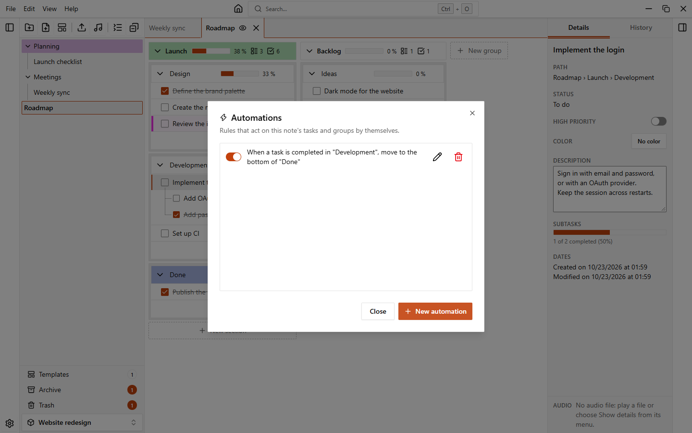
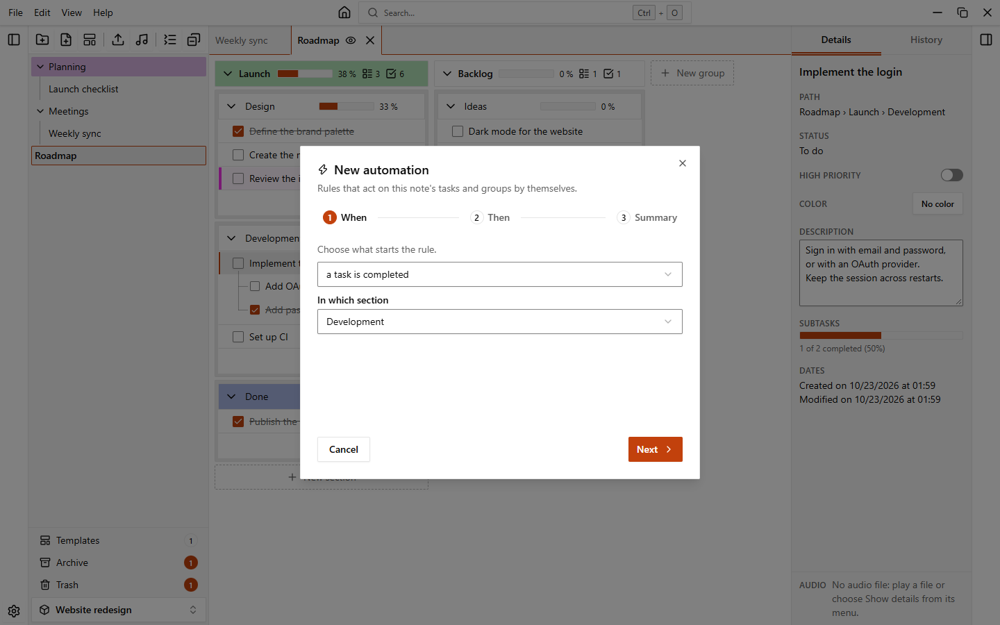

# Automations

Automations are rules that act by themselves on the tasks and groups of a note. For example: when a task is completed, move it to the **Done** section.

Every rule belongs to one note and only sees and changes that note.

## Open the automations of a note

1. Open the menu of the note in the sidebar (the **...** button or a right click).
2. Choose **Automations…**.

The menus of a group and of a section have the same entry, and open the automations of the note they belong to.

The dialog lists the rules of the note. A note needs at least one section before you can create a rule.

## Create a rule

Click **New automation**. The editor has three steps, shown at the top: **When**, **Then** and **Summary**. **Next** and **Back** move between them, and you can also click a step.

1. **When**: choose what starts the rule, then, where it applies: **In which section** for a task trigger (or **Any section**), or **Group** for a group trigger (or **Any group**).
2. **Then**: choose what should happen. Click **Add action** to add more actions, and the remove button to take one away.
3. **Summary**: you see the rule written as a sentence. You can give it a **Name (optional)** and turn **Rule enabled** on or off. Click **Save**.

If you leave the editor with unsaved changes, the app asks if you want to discard them.

## Triggers

| Trigger | Starts when | The actions apply to |
| --- | --- | --- |
| a task is completed | you complete a task | the task |
| a task is reopened | you reopen a completed task | the task |
| a task is created | you add a task | the task |
| a task arrives in the section | a task is moved into the section from another one | the task |
| all the subtasks of a task are completed | the last open subtask of a task is completed | the task |
| all the tasks of a group are completed | the last open task of a group is completed | the group |
| a section has no tasks to complete | see below | the section |
| a section has at least one task to complete | see below | the section |
| a group has no tasks to complete | see below | the group |
| a group has at least one task to complete | see below | the group |

The task triggers look at the top level tasks of a section, except for the subtasks one, which works at any depth. A group counts as completed when it has at least one task and all of them are completed.

### Event triggers and state triggers

The first six triggers are **events**: they run once, at the moment something happens.

The last four are **states**: they hold for as long as the note is in that state. A section or a group with no tasks counts as having no tasks to complete, and a task counts as done when it is completed or when all its subtasks are done. Because a state lasts, these triggers only allow the **Color** action.

::: tip
A state rule does not remove the color when the state ends. To turn a section back to normal, add a second rule with the opposite trigger and the **No color** value. For example: "a section has no tasks to complete" gives green, "a section has at least one task to complete" gives **No color**.
:::

## Actions

What you can choose depends on the trigger.

| Action | What it does | Available for |
| --- | --- | --- |
| **Move to** | Moves the task to a section of the note, **At the top** or **At the bottom** | task triggers |
| **Mark as** | Marks the task as **Completed** or **To do** | task triggers |
| **Priority** | **Add priority** or **Remove priority** | task triggers |
| **Color** | Gives a color, or **No color** | every trigger |
| **Complete all subtasks** | Completes every subtask of the task, at any depth | task triggers |
| **Move the group** | Moves the group **At the top** or **At the bottom** of the note | group event trigger |
| **Archive the group** | Archives the group | group event trigger |

**Move to** only moves top level tasks: a subtask stays under its parent. The color of an action uses the same [palette](./colors) as the rest of the app.

A rule can have several actions. They run in order. For example, "when a task is completed in **Development**, move it to the bottom of **Done** and color it green" is one rule with two actions.

## When a rule runs

Event rules run when you act on a task of the open note: you complete, reopen, create or move it. When a rule runs, a toast tells you which one ("Automation ran").

Some details:

- Rules run in the order of the list.
- The actions of a rule can start other rules, for example a task that is moved or completed. The chain has a limit, and a rule runs at most once for the same task in a chain, so two rules cannot move a task back and forth forever.
- A rule whose section or group has been deleted is shown as paused ("Paused: section deleted" or "Paused: group deleted") and does not run.

## Undo an automation

An automation is an action of its own in the history, separate from the one that started it.

- Press `Ctrl+Z` once to undo the automation, and a second time to undo what you did.
- Or click **Undo** in the toast. This only works while the automation is still your latest action. If you did something else in the meantime, the toast says "The automation is no longer the latest action: use the history to undo it."

See [Undo and history](./undo-and-history).

## Edit, disable and delete a rule

In the list of the dialog, each rule has:

- a switch to turn it on or off without deleting it;
- an edit button, which opens the rule on its summary;
- a delete button, which asks for confirmation.

## Duplicated notes, templates and exports

- **Duplicate** copies the automations of the note. The copies point to the sections and groups of the new note, so they never act on the original. Rules that refer to something outside the copied content are not copied.
- A [template](./templates) does not include automations. A note created from a template has none.
- Exporting and importing a workspace keeps the automations of its notes.
