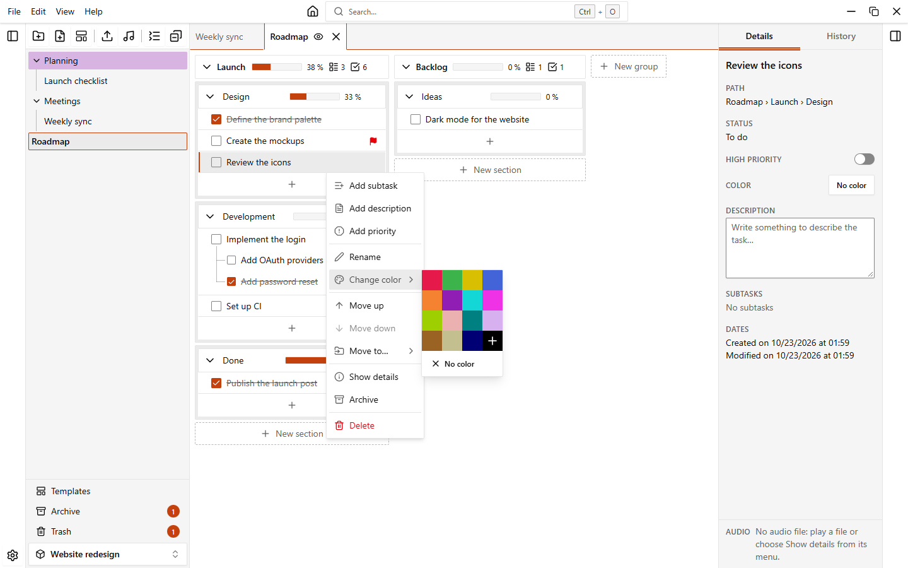

# Colors

You can give a color to workspaces, folders, notes, groups, sections and tasks. Colors help you find things at a glance.

## Give a color to an item

1. Open the menu of the item (the **...** button or a right click).
2. Choose **Change color**.
3. Click a color of the palette.

The menu of every item has this entry: workspaces on the home page, folders and notes in the sidebar, groups, sections and tasks in the note. The details panel also shows the color of the selected item in a **Color** field: click it to open the same palette.

## The palette

The palette has 15 colors:

| | | | |
| --- | --- | --- | --- |
| Red | Green | Yellow | Blue |
| Orange | Purple | Cyan | Magenta |
| Lime | Pink | Teal | Lavender |
| Brown | Cream | Navy | |

The last square of the palette, with a **+**, lets you pick **any other color** with the color picker of your system. The color is applied when you close the picker. A custom color is shown in that square when it is selected.

## Remove a color

Open the same palette and click **No color**.

## Color the content of a folder

The folder menu has **Color content**. It gives the color of the folder to all its subfolders and to all the notes inside them. Use it when you changed the color of a folder and want everything in it to match.

You can undo it, see [Undo and history](./undo-and-history).

## Color several items at once

Select folders and notes in the sidebar (`Ctrl+click` adds an item, `Shift+click` selects a range), open the menu of one of them and choose **Color**. The palette applies to the whole selection.

## Colors when you create something

The dialogs for a new workspace, folder and note have a palette button next to the name. Click it to choose a color before you create the item. A note created from a template starts with the color of the template, see [Templates](./templates).

## Colors in Settings

Open **Settings > Appearance**.

- **Accent color**: used for buttons, selections and highlights. A button resets it.
- **Color intensity**: how strongly the colors of folders, notes, groups and sections show. It goes from 25% to 175% (100% is the default) and has a **Reset** button. It does not change the color of the tasks.

### Contrast warning

If the accent color has too little contrast with the background of the current theme, a warning appears under the setting. Borders, selections and highlights may be hard to see with that color. The warning offers the closest color with enough contrast: click the **Use #XXXXXX** button (it shows the suggested color and its contrast ratio) to apply it. The check follows the theme you are using, so a color can be fine in the light theme and get a warning in the dark one.

## Colors set by automations

An [automation](./automations) can color a task, a group or a section by itself, for example a section that turns green when all its tasks are completed. You can also change that color by hand.

::: tip
The color intensity setting is useful when a very strong color hurts readability, or when pale colors are hard to see.
:::
