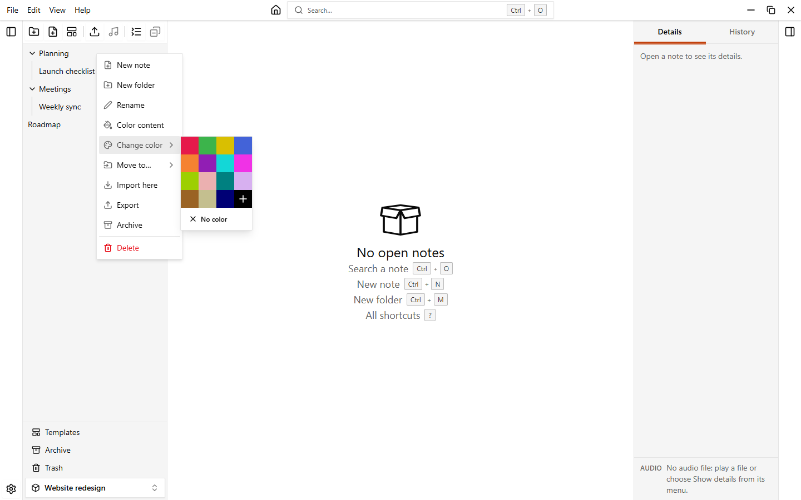
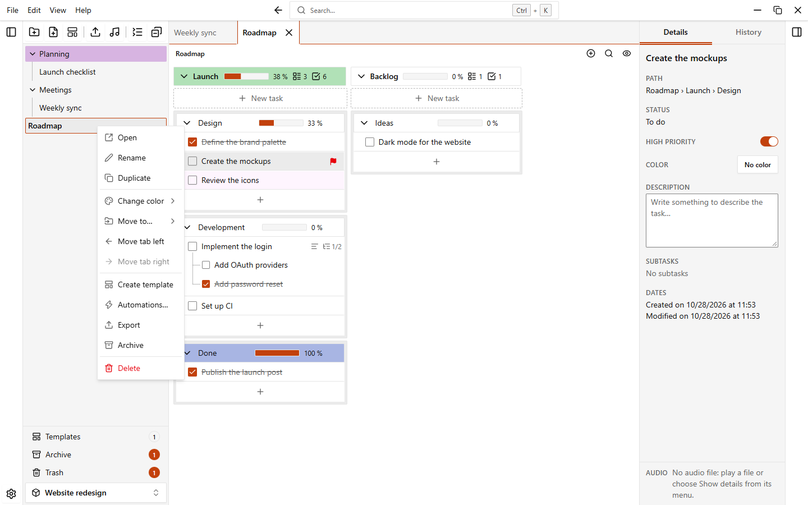
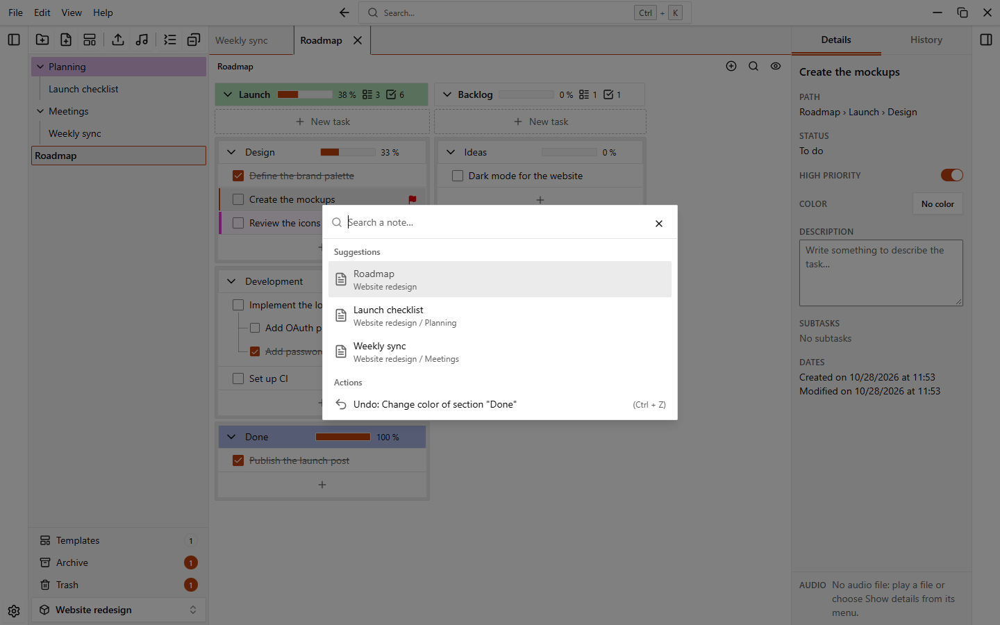

# Folders and notes

Inside a workspace, the left sidebar shows a tree of folders and notes. Folders can contain other folders without any depth limit. Notes hold your tasks and open as tabs.

{.light-only}
{.dark-only}

## The sidebar

The top of the sidebar has buttons, in three groups:

| Button                                   | What it does                                                    |
| ---------------------------------------- | --------------------------------------------------------------- |
| **New folder**, **New note**, **New note from template** | Create items. See below.                        |
| **Import a note or folder**              | Imports a `.easytask.json` file of a note or folder.            |
| Add audio files                          | Adds audio files to the first group of the open note. See [Audio files](./audio). |
| **Collapse all folders** / **Expand all folders** | Closes or opens every folder at once.                  |
| **Close all notes**                      | Closes every open tab.                                          |

At the bottom you find **Templates**, **Archive**, **Trash** (with a counter of what they hold) and the workspace selector, to jump to another workspace. See [Templates](./templates) and [Trash and archive](./trash-and-archive).

Right-click an empty area of the tree to get the same actions as the buttons.

### Show, hide and resize

- `Ctrl+B` shows or hides the sidebar. You can also use **View > Sidebar** in the application menu.
- Drag the edge of the sidebar to resize it. With the edge focused, `Left` and `Right` arrows change the width, `Shift` makes the step larger.
- In a narrow window (under 900 pixels) the sidebar becomes an overlay that starts closed and covers the note while it is open.

To make rows smaller or larger, go to **Settings > Appearance > Size of folders and notes** and choose **Compact**, **Normal** or **Large**.

## Create folders and notes

| Action                          | How                                                                                             |
| ------------------------------- | ----------------------------------------------------------------------------------------------- |
| New note in the workspace root  | **New note** button, `Ctrl+N`, or **File > New note**                                           |
| New folder in the workspace root| **New folder** button, `Ctrl+M`, or **File > New folder**                                       |
| New note or folder inside a folder | Open the menu of the folder and choose **New note** or **New folder**                        |
| New note from a template        | **New note from template** button, or **File > New note from template…**                        |

In the **New note** dialog type a **Name**. You can also pick a template in **From template** (the default is **No template**). In the workspace root you can give the note a color right away.

Names must be unique inside the same folder. If a name is already used, the dialog shows an error.

## Rename, color and move

Click the menu button of a row (it appears when you point at it) or right-click the row.

| Entry                | Folder | Note | What it does                                                                        |
| -------------------- | :----: | :--: | ----------------------------------------------------------------------------------- |
| **New note**, **New folder** | yes |  | Creates the item inside the folder.                                                  |
| **Open**             |        | yes  | Opens the note in a tab.                                                            |
| **Open on the right** |       | yes  | Opens the note in the right area, creating the split if needed. See [Split into two areas](#split-into-two-areas). |
| **Open on the left** |        | yes  | Moves a note of the right area to the left one (only if the note is open on the right). |
| **Rename**           | yes    | yes  | The name becomes a text field in place. `Enter` saves, `Esc` cancels.               |
| **Duplicate**        |        | yes  | Makes a copy named like `Roadmap (copy)` and opens it.                              |
| **Color content**    | yes    |      | Gives the color of the folder to every note and subfolder inside it.                |
| **Change color**     | yes    | yes  | Sets or removes the color of the item.                                              |
| **Move to…**         | yes    | yes  | Moves the item to another folder or to **Workspace root**.                          |
| **Move tab left**, **Move tab right** |  | yes | Reorders the tab (only if the note is open).                              |
| **Create template**  |        | yes  | Saves the note as a template. See [Templates](./templates).                         |
| **Automations…**     |        | yes  | Opens the automations of the note. See [Automations](./automations).                |
| **Import here**      | yes    |      | Imports a note or folder file inside the folder.                                    |
| **Export**           | yes    | yes  | Saves the item to a `.easytask.json` file.                                          |
| **Archive**          | yes    | yes  | Hides the item without deleting it.                                                 |
| **Delete**           | yes    | yes  | Moves the item to the trash, after confirming.                                      |

### Move with drag and drop

Drag a row in the tree and drop it where you want:

- On a note: the item goes before it (upper half) or after it (lower half).
- On a folder: in the middle of the row, the item goes inside the folder; near the top or bottom edge, before or after it.

You can also drag with the keyboard: focus a row, press `Space`, move with the arrow keys, press `Space` again to drop, `Esc` to cancel. **Move to…** in the menu is another way that needs no dragging.

::: info
A folder cannot be moved into itself or into one of its subfolders.
:::

### Select several items

1. `Ctrl`+click a row to add it to the selection or remove it.
2. `Shift`+click selects all the rows between the last clicked one and this one.
3. Right-click a selected row (or use its menu button) to act on the whole selection.

The menu then offers **Move**, **Color**, **Export**, **Archive** and **Delete** for all selected items, and you can drag the selection to move it all at once. `Esc` clears the selection. A plain click on a row clears it too.

## Open notes as tabs

Click a note in the sidebar to open it. Open notes appear as tabs above the note. Right-click a tab for the same menu of the note.

| Action                    | How                                                              |
| ------------------------- | ---------------------------------------------------------------- |
| Next note                 | `Ctrl+PageDown` or `Ctrl+Tab`                                    |
| Previous note             | `Ctrl+PageUp` or `Ctrl+Shift+Tab`                                |
| Close the active note     | `Ctrl+L`, or the **Close current note** button on the tab        |
| Close all notes           | `Ctrl+T`, or the **Close all notes** button in the sidebar       |
| Reorder tabs              | Drag a tab, or use **Move tab left** / **Move tab right**        |
| Split into two areas      | `Ctrl+\` (`Cmd+\` on macOS), or the **Split into two areas** button |

You can change every editable shortcut in **Settings > Shortcuts**. See [Keyboard shortcuts](./shortcuts).

### Split into two areas

You can keep two notes side by side. Each area has its own tab bar and its own open note.

- Click **Split into two areas** on the right of the path bar, or press `Ctrl+\` (`Cmd+\` on macOS). An empty area appears on the right. Click **Close the split** (or press the same shortcut) to go back to one area: this closes the tabs of the right area.
- A note is open in one area at a time. If you open a note that is already open in the other area, EasyTask switches to it there.
- To move a note, drag its tab to the other tab bar (or drop it in the empty bar). Without the mouse, use **Open on the right** / **Open on the left** in the menu of the note or of its tab, or press `Ctrl+Alt+→` (also `Ctrl+Alt+←`) to move the active note to the other area. **Open on the right** creates the split if there is none.
- `Ctrl+Alt+\` moves the focus to the other area.
- The area you clicked last is the focused one. The sidebar, the command menu, the details panel and the shortcuts (close the note, next or previous note, search in the note, new group, undo and redo) act on it.
- Drag the divider between the areas to resize them. With the divider focused, the arrow keys change the size (`Shift` for bigger steps), and a double click brings it back to 50%. Each area is at least 320 pixels wide, and the sidebars close by themselves when there is not enough room.

The split and the tabs of each workspace are reopened at the next start when **Reopen notes at startup** is on. There can be at most two areas.

The three shortcuts for the split can be changed in **Settings > Shortcuts**, except `Ctrl+Alt+←`.

### The path bar

Under the tabs, a thin bar shows the path of the open note, for example `Work > Projects > Plan`. Click a folder or the note in the path to show it in the sidebar: the sidebar opens if it was closed, the folders above it expand and the item is selected. A long path keeps the first folder and the last two items. On the right of the same bar you find the **Hide completed tasks** button and the **Split into two areas** button (it reads **Close the split** while the view is split).

### What is reopened at startup

When you open a workspace, EasyTask reopens the notes that were open, the active one and the split into two areas (if you used it). This is saved for each workspace. To turn it off, go to **Settings > Notes and sections** and switch off **Reopen notes at startup**. The same page has **Reopen the last workspace at startup**.

## Search a note

Press `Ctrl+K`, or click the **Search…** field at the top of the window, then type part of a note name. The list shows each match with the path of its folder. Choose one to open it.

The same list also offers the last action you can undo or redo. See [Undo and history](./undo-and-history).
