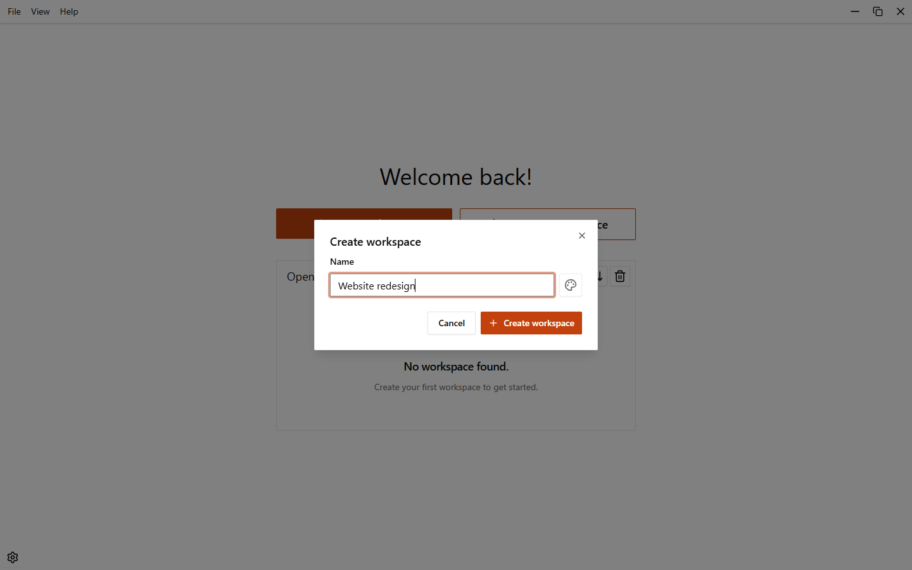
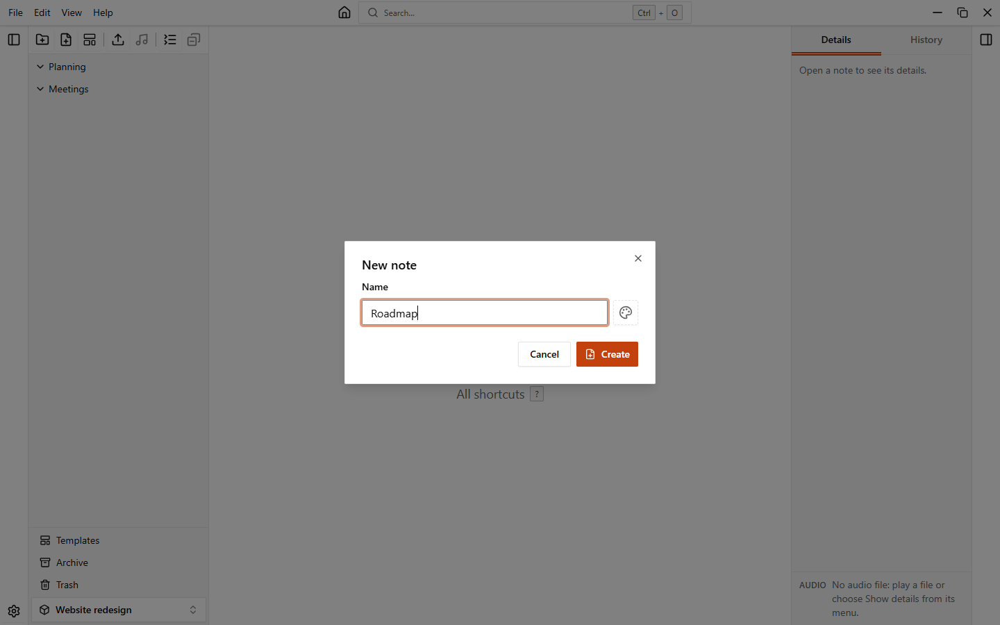
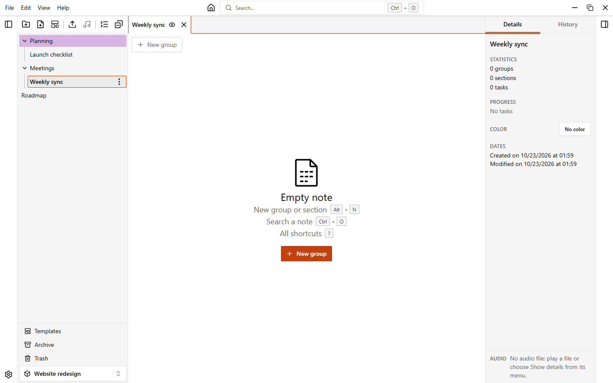
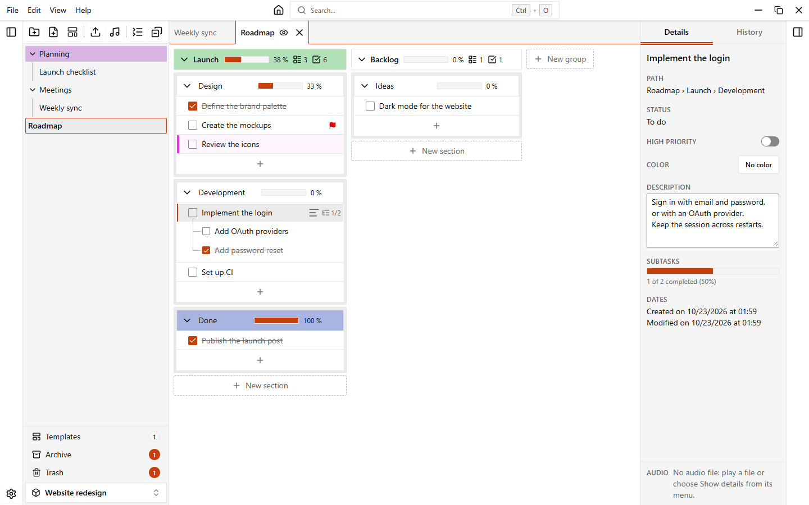
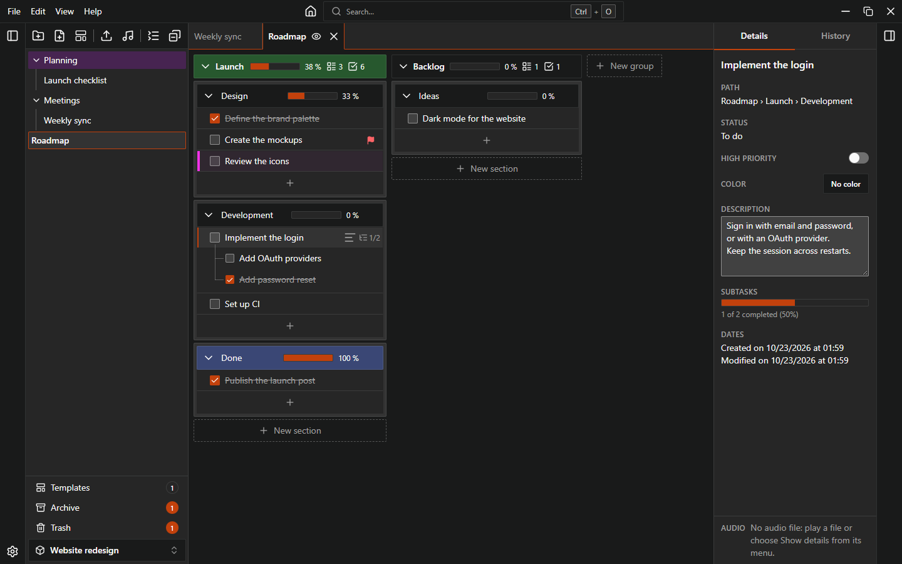

# Getting started

This walkthrough takes you from an empty app to a note with a few tasks.

## 1. Create a workspace

On the home page, click **New workspace** (or press `Ctrl+N`). Type a name in the **Create workspace** dialog and confirm.

Open the workspace from the list on the home page.

## 2. Create a folder and a note

In the sidebar, click **New folder** and give it a name. Folders are optional: you can also create notes directly in the workspace.

To create a note, click **New note** (or press `Ctrl+N`). In the **New note** dialog, type a name and click **Create**. You can also start from a template: see [Templates](./templates).

The note opens in a tab. Open notes stay in the tab bar.

## 3. Add a group and a section

A new note is empty. Click **New group** (or press `Alt+N`) to add a group. A group holds sections: add a section with **New section**.

Groups and sections can be left without a name. To name one, click its name and type.

## 4. Add tasks and sub-tasks

In a section, click **Add task** and type the text of the task. Confirm with `Enter`.

To add a sub-task, open the menu of a task and choose **Add subtask**. Sub-tasks can have their own sub-tasks.

## 5. Complete a task

Click the checkbox of a task to complete it. A task with sub-tasks shows how many are completed, and sections and groups can show a progress bar (see [Settings](./settings)). To hide completed tasks, press `Ctrl+Shift+H`.

## 6. Open the details panel

Select a task and open the details panel with `Ctrl+Shift+B`, or from **View > Details panel** in the menu. The panel shows the task details and its sub-tasks.

{.light-only}
{.dark-only}

## Next steps

- [Workspaces](./workspaces)
- [Folders and notes](./folders-and-notes)
- [Groups, sections and tasks](./groups-sections-tasks)
- [Colors](./colors)
- [Automations](./automations)
- [Templates](./templates)
- [Trash and archive](./trash-and-archive)
- [Undo and history](./undo-and-history)
- [Audio](./audio)
- [Keyboard shortcuts](./shortcuts)
- [Settings](./settings)
- [Data and backups](./data-and-backups)
- [Updates](./updates)
- [Troubleshooting](./troubleshooting)
