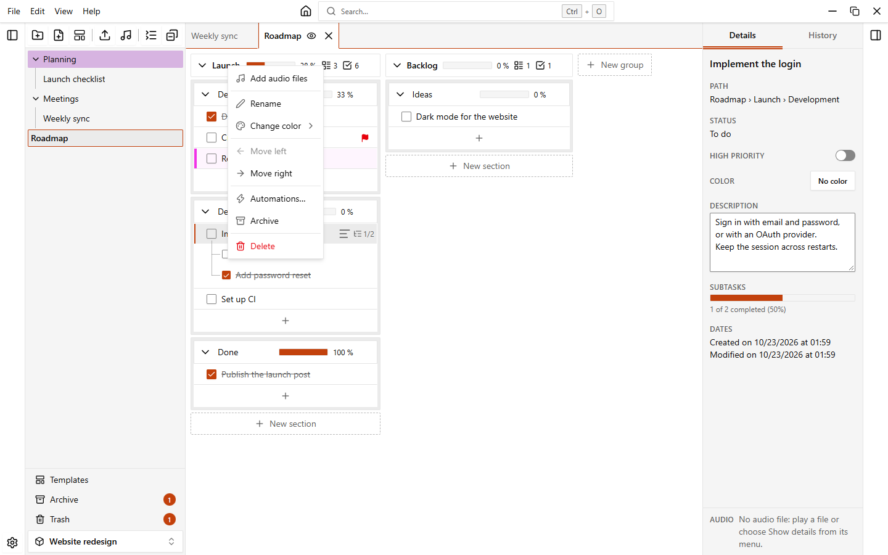
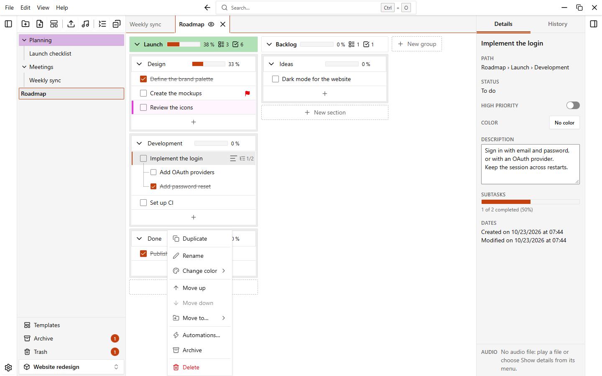
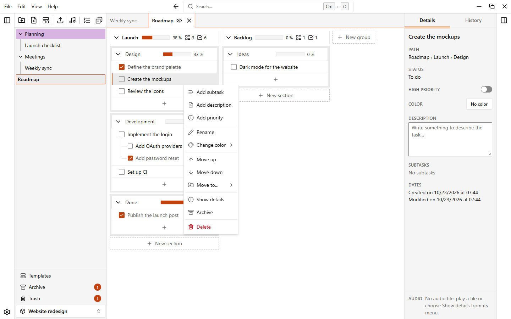
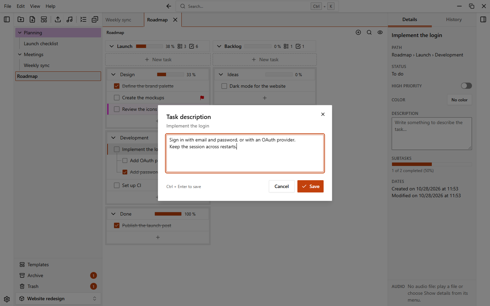

# Groups, sections and tasks

The content of a note is organized in three levels. A note holds **groups**, shown side by side as columns. A group holds **sections**, stacked in the column. A section holds **tasks**, and a task can have **subtasks**, as deep as you need.

{.light-only}
{.dark-only}

## Groups and sections

### Add them

- Click **New group**, or press `Alt+N`, type a name and press `Enter`. `Esc` closes the field.
- Inside a group, click **New section**, type a title and press `Enter`.

The name is optional: press `Enter` on an empty field and the group or section is created without a name. EasyTask then shows **Group 1**, **Group 2**… or **Untitled section** in muted text. You can hide those labels with **Settings > Notes and sections > Show names of unnamed groups and sections**.

### Rename, color and manage

Click the name to rename it in place (`Enter` saves, `Esc` cancels), or open the menu of the group or section with its menu button or a right-click.

A right-click on the empty area of the note (outside any group, section or task) opens a small menu with **New group** and **Hide / Show completed tasks**.

| Entry                                  | Group | Section | What it does                                                    |
| -------------------------------------- | :---: | :-----: | --------------------------------------------------------------- |
| **Add audio files**                    | yes   |         | Adds audio files to the group. See [Audio files](./audio).      |
| **Duplicate**                          |       | yes     | Copies the section, with its tasks, right after the original.   |
| **Rename**                             | yes   | yes     | Edits the name.                                                 |
| **Change color**                       | yes   | yes     | Sets or removes the color.                                      |
| **Move left**, **Move right**          | yes   |         | Moves the group one step in the row.                            |
| **Move up**, **Move down**             |       | yes     | Moves the section one step in its group.                        |
| **Move to…**                           |       | yes     | Moves the section to the end of another group, or to a **New group**. |
| **Automations…**                       | yes   | yes     | Opens the automations of the note. See [Automations](./automations). |
| **Archive**                            | yes   | yes     | Hides it without deleting. See [Trash and archive](./trash-and-archive). |
| **Delete**                             | yes   | yes     | Moves it to the trash.                                          |

You can also move things by dragging:

- Drag a group by its header to reorder the groups.
- Drag a section onto another group, or between sections, to move it. Drop it on the **New group** area at the edge to make it a group of its own.

### Collapse, counters and progress bars

Each group and section has a button to collapse it (**Collapse group**, **Collapse section**). A group can show how many sections, tasks and audio files it holds. Groups and sections can also show a progress bar with the percentage of completed tasks (for a group, tasks and subtasks all count). Choose what to show in **Settings > Notes and sections**: **Show progress bar in sections**, **Show progress bar in groups**, **Show number of sections**, **Show number of tasks**, **Show number of audio files**. The option **Lines between groups** draws a thin guide between the columns.

## Tasks and subtasks

### Add a task

1. At the bottom of a section click the **+** button (**Add task**).
2. Type the text in **New task…** and confirm with `Enter` or the add button. `Esc` closes the field.

New tasks go to the end of the section. To put them at the top, choose **At the top** in **Settings > Notes and sections > Position of new tasks**.

### Add a subtask

Point at a task and click **Add subtask**, or choose it from the task menu. Type the text and press `Enter`: the field stays open for the next subtask. `Esc` closes it. Subtasks can have their own subtasks, with no limit. The task shows how many of its subtasks are done (for example `1/3`) if **Show completed subtasks** is on.

### Edit and complete

- Tick the checkbox to complete a task, untick it to reopen it.
- Click the text to edit it. `Enter` saves, `Esc` cancels. If you prefer to avoid accidental edits, turn off **Rename by clicking the name**: then use **Rename** in the menu or press `Enter` on the name.

### Priority, description and color

Open the menu of the task (menu button or right-click):

| Entry                                      | What it does                                                          |
| ------------------------------------------ | --------------------------------------------------------------------- |
| **Add subtask**                            | Adds a subtask.                                                       |
| **Add description** / **Remove description** | Opens a window where you write the **Description**. `Shift+Enter` adds a new line, `Ctrl+Enter` saves. |
| **Add priority** / **Remove priority**     | Marks the task as high priority. A flag appears on the task.          |
| **Rename**                                 | Edits the text.                                                       |
| **Change color**                           | Colors the task with a side bar (and a light background, if you want it). |
| **Move up**, **Move down**                 | Moves the task one step among its siblings.                           |
| **Move to…**                               | Moves the task to another section, or under another task as a subtask.|
| **Show details**                           | Selects the task in the details panel.                                |
| **Archive**, **Delete**                    | Hide it or move it to the trash, with its subtasks.                   |

A task with a description shows a small icon: click it to read the description. The look of the tasks is set by **Task density** (**Compact**, **Normal**, **Roomy**) and **Colored task background**.

### Move tasks

Drag a task by its row. Drop it:

- between two tasks, to reorder them;
- on the middle of a task, to make it a subtask of that task;
- on a section, to make it the last task of that section.

**Move up**, **Move down** and **Move to…** in the menu do the same without dragging.

### Select several tasks

Hold **Ctrl** (**Cmd** on macOS) and click to add a task to the selection or remove it. Click a task with **Shift** to select every visible task between the last one you clicked and this one, across sections and groups. **Esc** clears the selection, and so does a plain click.

Right click a selected task (or open its menu) to act on all of them at once: **Delete**, **Archive**, **Color** and **Move to…** (the end of a section, or the tasks directly in a group). A selected task stands for its subtasks too, so they are deleted, archived and moved with it. Each action is a single step in the [undo history](./undo-and-history.md). Dragging still moves one task at a time.

## Hide completed tasks

Press `Ctrl+Shift+H`, use the eye button in the path bar above the groups, or choose **View > Hide completed tasks**. Completed tasks and their subtasks disappear, and each section tells you how many are hidden. A completed task that still has an open subtask stays visible, so open work is never lost. Nothing is deleted: press the shortcut again to see them. To start hidden, use **Settings > Notes and sections > Hide completed tasks**.

## The details panel

The panel on the right has two tabs. Open or close it with `Ctrl+Shift+B` or **View > Details panel**.

**Details** shows:

- for a selected task (click it): its path, status, a switch for **High priority**, the **Color**, the **Description** (editable, with **Save** and **Cancel**), the progress of its subtasks and its dates;
- for the note, when no task is selected: the number of groups, sections and tasks, the overall progress, the color and the dates.

**History** lists the actions you can undo and redo. See [Undo and history](./undo-and-history).

## Small windows

Under 900 pixels of width, the sidebar and the details panel become overlays that start closed and cover the note while open. Open them with `Ctrl+B` and `Ctrl+Shift+B`.

## Spell check

EasyTask underlines misspelled words while you type. Turn it off with **Settings > Notes and sections > Spell check**.
