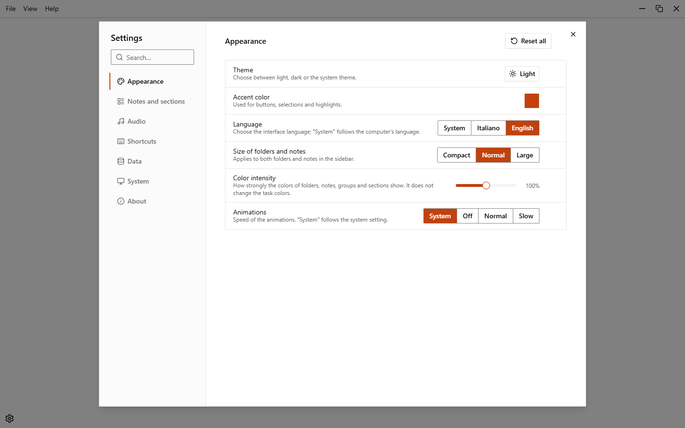
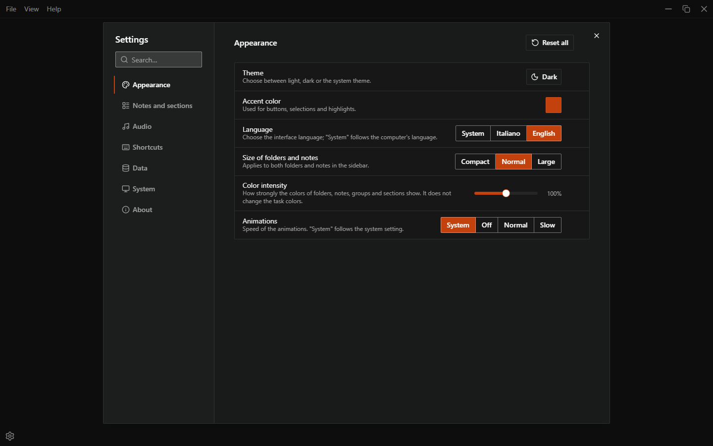
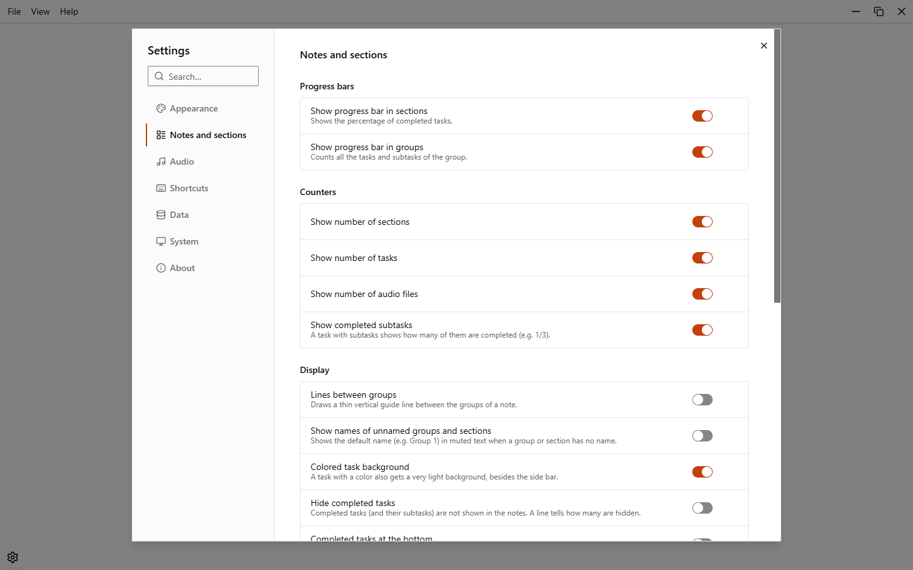
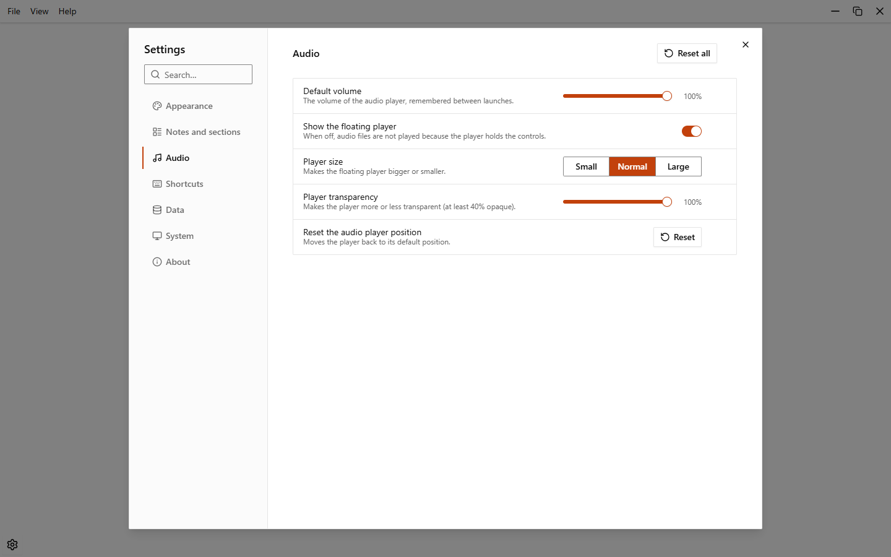
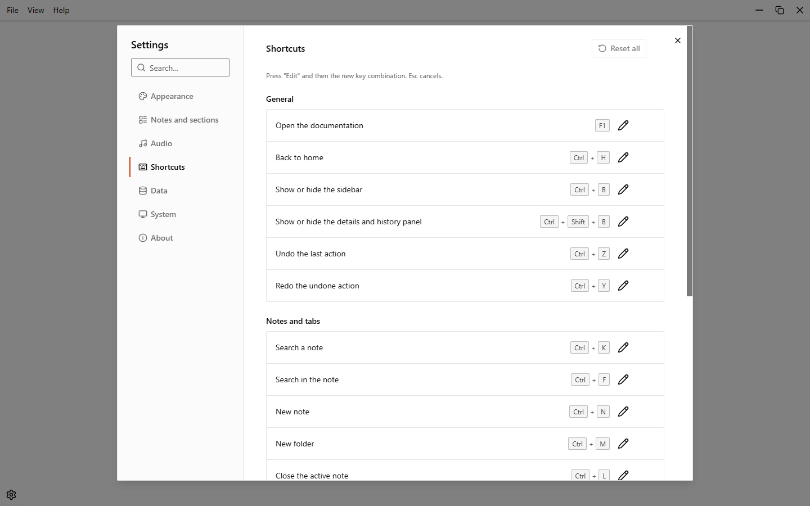
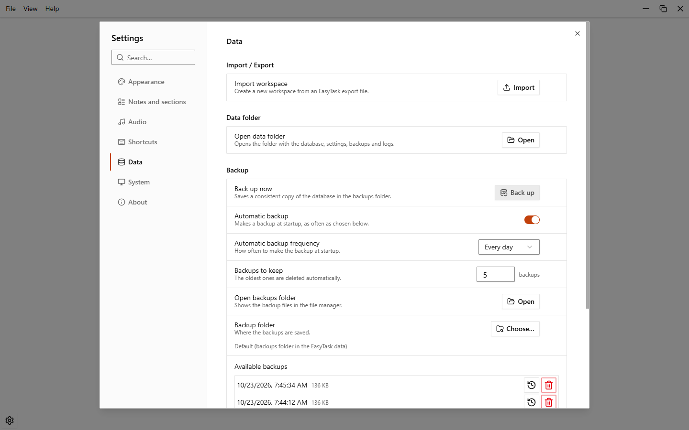
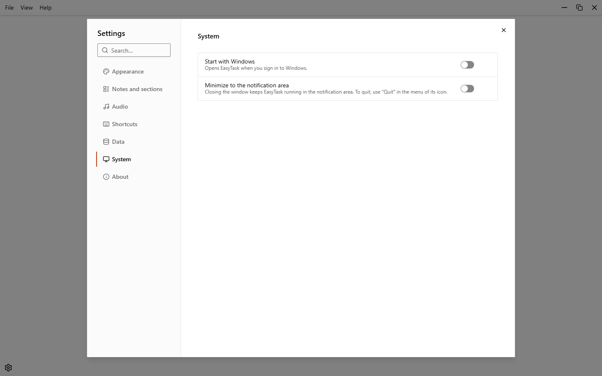
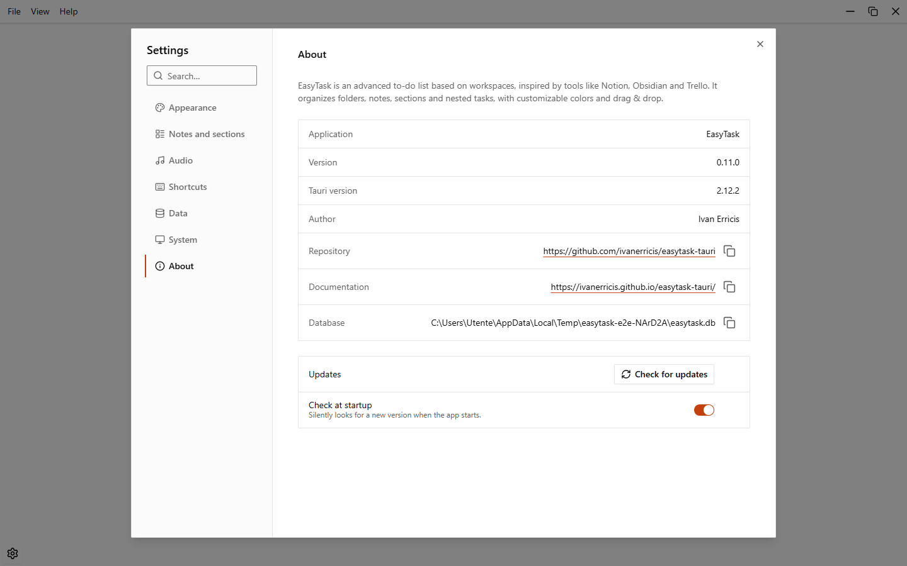

# Settings

Open the settings from the app menu (**File > Settings…**). Options are grouped in seven categories. Changes apply at once and are saved automatically.

## Search the settings

Type in the **Search settings…** box at the top left to find an option by its name or description. The search looks in all categories and shows only the matching rows. Accents do not matter.

Press `Esc`, click the X button or choose a category to clear the search.

## Reset buttons

- A row that differs from its default shows a small reset arrow next to it (accent color, color intensity, each shortcut).
- **Reset all** at the top of a category puts the whole category back to its defaults. It is in Appearance, Audio and Shortcuts. Appearance and Shortcuts ask for confirmation first. Your data is never touched.

## Appearance

{.light-only}
{.dark-only}

| Option | Choices | Default |
| --- | --- | --- |
| Theme | Light, Dark, System | System |
| Accent color | Any color | Orange (`#c2410c`) |
| Language | System, Italiano, English | System |
| Size of folders and notes | Compact, Normal, Large | Normal |
| Color intensity | Slider from 25% to 175% | 100% |
| Animations | System, Off, Normal, Slow | System |

If the accent color has little contrast with the background, EasyTask warns you and suggests a close color that is easier to see. Color intensity changes folders, notes, groups and sections, not the task colors.

## Notes and sections

| Option | Choices | Default |
| --- | --- | --- |
| **Progress bars**: Show progress bar in sections | On / Off | On |
| Show progress bar in groups | On / Off | On |
| **Counters**: Show number of sections | On / Off | On |
| Show number of tasks | On / Off | On |
| Show number of audio files | On / Off | On |
| Show completed subtasks | On / Off | On |
| **Display**: Lines between groups | On / Off | Off |
| Show names of unnamed groups and sections | On / Off | Off |
| Colored task background | On / Off | On |
| Hide completed tasks | On / Off | Off |
| Task density | Compact, Normal, Roomy | Normal |
| **Behavior**: Rename by clicking the name | On / Off | On |
| Keep adding tasks (the field stays open after creating a task) | On / Off | On |
| Line to insert a task (a line with a + between two tasks; with Keep adding tasks the field moves under the new task) | On / Off | On |
| Position of new tasks | At the top, At the bottom | At the bottom |
| Spell check | On / Off | On |
| Confirm deleting only when there is content (notes, sections and groups: with it on, empty ones go straight to the trash with **Undo**, the others ask first; off never asks. Folders, workspaces, tasks and multiple selections always ask) | On / Off | On |
| **On startup**: Reopen the last workspace at startup | On / Off | Off |
| Reopen notes at startup | On / Off | On |

## Audio

| Option | Choices | Default |
| --- | --- | --- |
| Default volume | Slider from 0% to 100% | 100% |
| Show the floating player | On / Off | On |
| Player size | Small, Normal, Large | Normal |
| Player transparency | Slider from 40% to 100% opacity | 100% |
| Reset the audio player position | Button | |

When **Show the floating player** is off, audio files are not played. See [Audio files](./audio).

## Shortcuts

Lists every shortcut you can change, grouped as in the shortcuts dialog. See [Keyboard shortcuts](./shortcuts#change-a-shortcut).

## Data

| Section | Option | Choices | Default |
| --- | --- | --- | --- |
| Import / Export | Import workspace | Button | |
| Import / Export | Export current workspace | Button (only inside a workspace) | |
| Data folder | Open data folder | Button | |
| Backup | Back up now | Button | |
| Backup | Automatic backup | On / Off | On |
| Backup | Automatic backup frequency | Every day, Every week, Every month | Every day |
| Backup | Backups to keep | 1 to 100 | 5 |
| Backup | Open backups folder | Button | |
| Backup | Backup folder | **Choose…** or **Use the default** | Default (`backups` in the data folder) |
| Trash | Empty the trash automatically | Never, After 7 days, After 30 days, After 90 days | Never |
| History | Undoable actions | 25, 50, 100, 200, 500 | 50 |

Backups, restore and the data folder are explained in [Data and backups](./data-and-backups). The history limit is explained in [Undo and history](./undo-and-history).

## System

| Option | What it does | Default |
| --- | --- | --- |
| Start with Windows | Opens EasyTask when you sign in to Windows | Off |
| Minimize to the notification area | Closing the window keeps EasyTask running in the notification area. Use **Quit** in the menu of its icon to exit. The icon menu also has **Open EasyTask** | Off |
| Remember window position and size | The window comes back where you left it at the next start. Not available in the portable version | On |
| Keep the window on top | EasyTask stays above the other windows; applies at once and is remembered at startup | Off |

## About

Shows the version, the author and the repository, and the path of the database. It also has **Check for updates** and the **Check at startup** switch (on by default). See [Updates](./updates).
