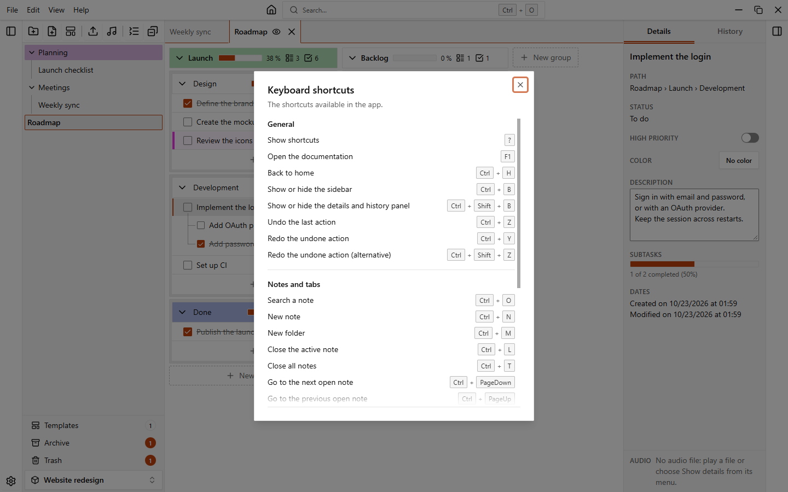
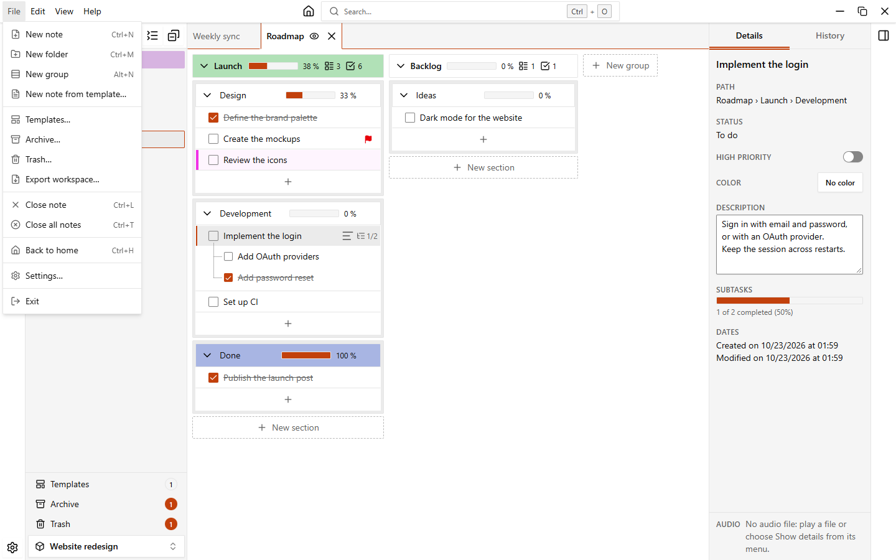

# Keyboard shortcuts

EasyTask has keyboard shortcuts for the most common actions. Press `?` to see the full list, or choose **Help > Keyboard shortcuts…** in the app menu.

The shortcuts work when you are not typing, with a few exceptions: the shortcuts for tabs, sidebars, search, back to home, hiding completed tasks and new group also work inside text fields. `Ctrl+Z` and `Ctrl+Y` do not, because the field has its own undo.

## General

| Action | Shortcut | Can be changed |
| --- | --- | --- |
| Show shortcuts | `?` | No |
| Open the documentation | `F1` | Yes |
| Back to home | `Ctrl+H` | Yes |
| Show or hide the sidebar | `Ctrl+B` | Yes |
| Show or hide the details and history panel | `Ctrl+Shift+B` | Yes |
| Undo the last action | `Ctrl+Z` | Yes |
| Redo the undone action | `Ctrl+Y` | Yes |
| Redo the undone action (alternative) | `Ctrl+Shift+Z` | No |

## Notes and tabs

| Action | Shortcut | Can be changed |
| --- | --- | --- |
| Search a note | `Ctrl+O` | Yes |
| New note | `Ctrl+N` | Yes |
| New folder | `Ctrl+M` | Yes |
| Close the active note | `Ctrl+L` | Yes |
| Close all notes | `Ctrl+T` | Yes |
| Go to the next open note | `Ctrl+PageDown` | Yes |
| Go to the previous open note | `Ctrl+PageUp` | Yes |
| Go to the next open note (alternative) | `Ctrl+Tab` | No |
| Go to the previous open note (alternative) | `Ctrl+Shift+Tab` | No |
| Hide or show completed tasks | `Ctrl+Shift+H` | Yes |
| Play or pause the audio | `Alt+P` | Yes |

## Groups, sections and tasks

| Action | Shortcut | Can be changed |
| --- | --- | --- |
| New group or section | `Alt+N` | Yes |
| Confirm editing a group, section or task name | `Enter` | No |
| Cancel renaming the group or close the new subtask | `Esc` | No |
| New line in a task description | `Shift+Enter` | No |

## Home page

| Action | Shortcut | Can be changed |
| --- | --- | --- |
| New workspace | `Ctrl+N` | Yes |

`Ctrl+N` is **New note** inside a workspace and **New workspace** on the home page.

## The app menu

The menu bar at the top has **File**, **Edit**, **View** and **Help**. Press and release `Alt` on its own, or press `F10`, to move the focus to it, then use the arrow keys. Press `Alt` again to go back to where you were. The menu entries show their shortcut.

## Change a shortcut

1. Open **Settings > Shortcuts**.
2. Click the pencil next to the action.
3. Press the new key combination. `Esc` cancels.
4. If the combination is already used, EasyTask tells you by which action. Pick another one.

A shortcut must use `Ctrl` or `Alt`, except function keys such as `F5`.

An action with a custom shortcut shows a reset button. Click it to go back to the default for that action. **Reset all** at the top puts every shortcut back to its default.

Only the shortcuts marked "Yes" above appear in **Settings > Shortcuts**.
