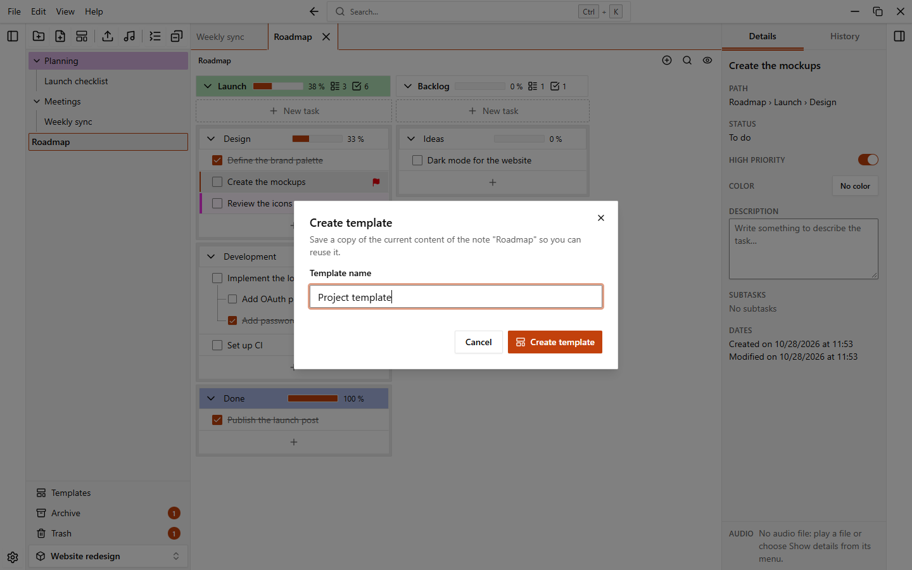
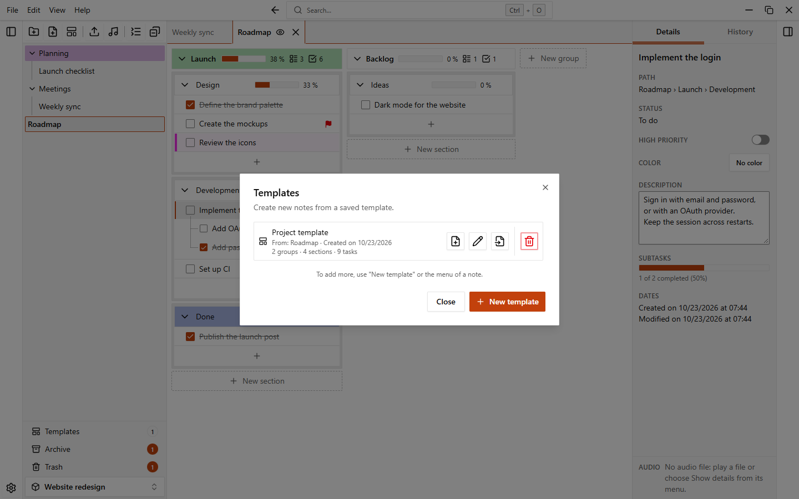

# Templates

A template is a saved copy of a note. Use it to start new notes from the same structure, for example a weekly plan or a project checklist.

Templates belong to a workspace: each workspace has its own, and they are not shared between workspaces.

## Create a template from a note

1. Open the menu of the note in the sidebar (the **...** button or a right click).
2. Choose **Create template**.
3. Type a **Template name** and confirm.

You can also open the templates dialog and click **New template**: it asks you to choose a note, then the name. The name must be unique in the workspace.

### What a template copies

The template is an independent snapshot of the note at that moment. Later changes to the note do not change it.

| Copied | Not copied |
| --- | --- |
| Groups, sections, tasks and subtasks, in their order (also the place of the group tasks list) | Audio files |
| Task descriptions, completed state and priority | Archived groups, sections and tasks |
| The colors of the note, groups, sections and tasks | Items in the trash |
| | [Automations](./automations) |

## Create a note from a template

There are three ways:

- In the **New note** dialog, choose a template in the **From template** field. The field appears when the workspace has at least one template. **No template** creates an empty note.
- In the menu **File > New note from template…** (or the button **New note from template** at the bottom of the sidebar). Choose the template, then fill in the dialog.
- In the templates dialog, click **Create note** on the template you want.

The **New note from template** dialog asks for a **Name** and a **Destination**: the workspace root or one of the folders. Click **Create**. The note is added at the end of the destination and opens. It starts with the color of the template.

## The templates dialog

Open it from the **Templates** button at the bottom of the sidebar (it shows how many templates you have), or from **File > Templates…**.

Use the search box to find a template. Each template shows the note it was made from and its creation date. The buttons of a template are:

| Button | What it does |
| --- | --- |
| **Create note** | Creates a note from the template |
| **Edit** | Opens the template in a tab to edit it (see [Edit a template](#edit-a-template)) |
| Rename | Changes the name of the template |
| **Update from note** | Replaces the content of the template with the current content of the source note. The app asks you to confirm with **Overwrite template**. Notes already created from the template do not change |
| **More actions** (**...**) | **Duplicate** makes a copy of the template. **Refresh from another note** replaces its content with that of a note you choose, which becomes the source note (the app asks you to confirm) |
| **Delete** | Moves the template to the trash |

**Update from note** is disabled when the source note no longer exists or is in the trash ("The source note no longer exists"), and also while the template is open in its editor (close the editor first).
## Edit a template

Click **Edit** on a template: it opens in a tab of the open notes, marked with the **Template** badge so you never mistake it for a note. You edit it like any other note: add groups, sections and tasks, change colors, drag to reorder, undo and redo.

- **Saved automatically.** There is no save button. A short status next to the path shows **Saving...** and then **Saved**; if saving fails it shows an error with **Retry**. Notes already created from the template do not change.
- **Duplicate.** In the **...** menu of the template, **Duplicate** creates a copy you can edit separately.
- **Refresh from another note.** In the same menu, **Refresh from another note...** replaces the content with that of a note you choose, which becomes the source note.
- **Recovery.** If the app is closed while a template is open, the changes are not lost. With the option **Reopen notes at startup** on, the tab opens again where you left it. With the option off, the changes are saved into the template at startup and a notice tells you they were recovered.

In a template, the actions that make no sense are hidden: archive, audio and [automations](./automations). Deleting an item shows a short "Deleted" notice instead of the usual one, and undo works on the template while its tab is open.

Close the tab (or use **Close editor** in its menu) when you are done; the template keeps what you wrote.
A deleted template goes to the trash, in the **Templates** tab: you can restore it there. See [Trash and archive](./trash-and-archive).
