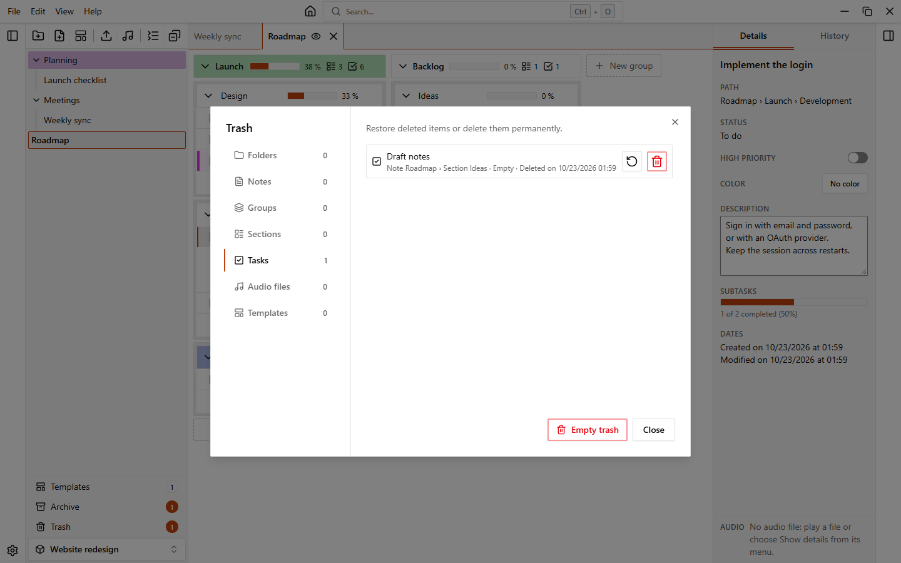
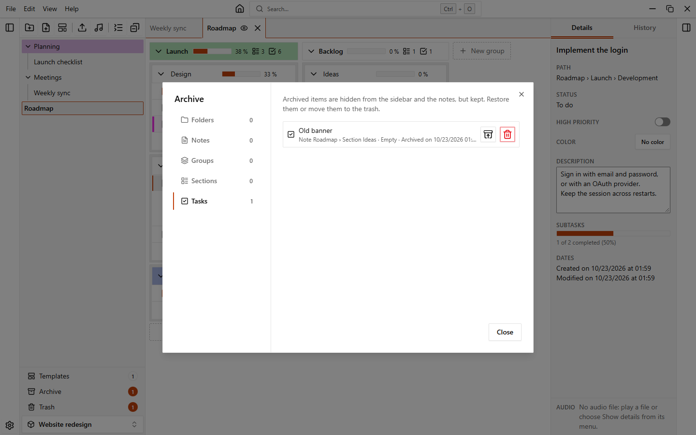

# Trash and archive

When you delete something, it goes to the trash first, so you can bring it back. The archive is for things you want to hide but keep.

## Move to the trash

Open the menu of an item and choose **Delete**. The app asks "Move to trash?" and you confirm with **Move to trash**. You can delete workspaces, folders, notes, groups, sections, tasks, audio files and [templates](./templates).

To delete several folders and notes at once, select them in the sidebar (`Ctrl+click` adds an item, `Shift+click` selects a range), open the menu of one of them and choose **Delete N items**.

Deleting is always reversible while the item is in the trash. You can also undo it with `Ctrl+Z`, see [Undo and history](./undo-and-history).

## The trash of a workspace

Open it with the **Trash** button at the bottom of the sidebar (it shows how many items it holds) or with **File > Trash…**.

The items are grouped by type, one tab for each: **Folders**, **Notes**, **Groups**, **Sections**, **Tasks**, **Audio files** and **Templates**. Each tab shows how many items it has. A row shows the name, where the item was, what it contained and when it was deleted ("Deleted on…").

| Button | What it does |
| --- | --- |
| **Restore** | Brings the item back |
| **Delete permanently** | Deletes the item for good. The app asks you to confirm and says it cannot be undone |
| **Empty trash** | At the bottom of the dialog: deletes everything in the trash of the workspace, after a confirmation |

When you restore an item that was inside something that is also in the trash (for example a task in a deleted note), the containers come back with it, so the item is never lost out of sight.

::: warning
**Delete permanently** and **Empty trash** cannot be undone. They also clear the undo history.
:::

## The trash of the workspaces

On the home page, the trash button next to the workspaces (or **File > Trash…**) opens the trash of the workspaces. It has the same buttons, and each row says how many folders and notes come back with the workspace.

## Empty the trash automatically

EasyTask can delete old items from the trash by itself.

1. Open **Settings > Data**.
2. In the **Trash** section, choose a value for **Empty the trash automatically**.

| Option | Effect |
| --- | --- |
| **Never** | Nothing is deleted by itself. This is the default |
| **After 7 days** | |
| **After 30 days** | |
| **After 90 days** | |

When the app starts, it permanently deletes what has been in the trash for longer than the chosen time, in every workspace. A message tells you how many items were deleted.

## The archive

Archiving hides an item from the sidebar and from the note without moving it to the trash. Use it for things you are done with but may need again.

You can archive folders, notes, groups, sections and tasks. What an item contains is hidden with it: an archived folder hides its notes, an archived task hides its subtasks.

To archive an item, open its menu and choose **Archive**. There is no confirmation, and you can undo it with `Ctrl+Z`. To archive several folders and notes at once, select them and choose **Archive N items** in the menu.

An [automation](./automations) can also archive a group.

## The archive dialog

Open it with the **Archive** button at the bottom of the sidebar (with the number of archived items) or with **File > Archive…**.

There is one tab for each type: **Folders**, **Notes**, **Groups**, **Sections** and **Tasks**. A row shows the name, where it was and when it was archived ("Archived on…").

| Button | What it does |
| --- | --- |
| **Restore** | Brings the item back where it was. If it is inside archived items (for example a task in an archived group), they come back too |
| **Move to trash** | Moves the item to the trash, after a confirmation |
