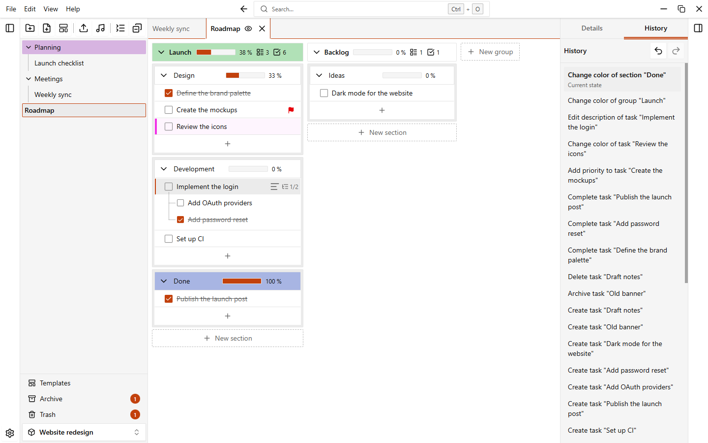

# Undo and history

EasyTask remembers your latest actions in the open workspace. You can undo them, redo them, or jump back to any point in the **History** tab.

## Undo and redo

| Action | Shortcut |
| --- | --- |
| Undo the last action | `Ctrl+Z` |
| Redo the undone action | `Ctrl+Y` or `Ctrl+Shift+Z` |

You can also use **Undo** and **Redo** in the **Edit** menu of the app menu, or the two buttons at the top of the History tab.

A toast confirms every undo and redo, for example "Undone: Rename task". The toast has a button for the opposite action, so you can change your mind at once.

::: info Text fields
Inside a text field, `Ctrl+Z` and `Ctrl+Y` undo and redo the text you are typing, not the workspace history. Click outside the field to use the workspace history.
:::

You can change `Ctrl+Z` and `Ctrl+Y` in **Settings > Shortcuts**. `Ctrl+Shift+Z` is fixed. See [Keyboard shortcuts](./shortcuts).

## What you can undo

You can undo the changes you make to the content of a workspace, such as:

- renaming a folder, note, group, section or task
- changing a color, also on several items at once
- completing or reopening a task, adding or removing its priority, editing its description
- creating an item
- deleting an item, or several selected items (they come back from the [trash](./trash-and-archive))
- archiving and unarchiving
- moving folders, notes, sections and tasks, also by drag and drop
- applying an [automation](./automations)

Each entry in the history has a name that says what it did, such as "Delete task "Buy milk"" or "Archive 3 items".

## Undo from a toast

When you delete something, the toast that confirms it has an **Undo** button. Click it to bring the items back. The button undoes the last action, so use it right after the delete.

The toast of an automation has the same button. If you have done something else since, use the history instead.

## The History tab

Open the right panel and choose the **History** tab. Show or hide the panel with `Ctrl+Shift+B`.

- The list shows the actions you can undo, the most recent first. The top one is marked **Current state**.
- Click an entry to go back to that point. EasyTask undoes every action above it, in one step.
- Below the line, the actions you have undone are marked **Undone**. Click one to redo everything up to it.

An action on several selected items (folders, notes or tasks) is a single entry, however many items it touches.

Doing a new action clears the undone list: you can no longer redo what you undid before.

## Limits

- The history belongs to the open workspace. It is emptied when you open another workspace or go back to the home page.
- It is kept in memory only. When you close the app, it is gone.
- It is emptied when you delete an item permanently from the trash or empty the trash.
- By default the last 50 actions are kept. Choose 25, 50, 100, 200 or 500 in **Settings > Data > History > Undoable actions**. Older actions are forgotten.
- An action that fails when you undo it is removed from the history, and a toast tells you.
