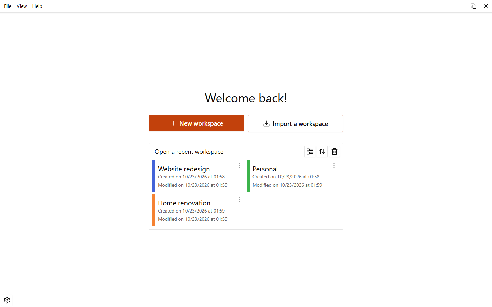
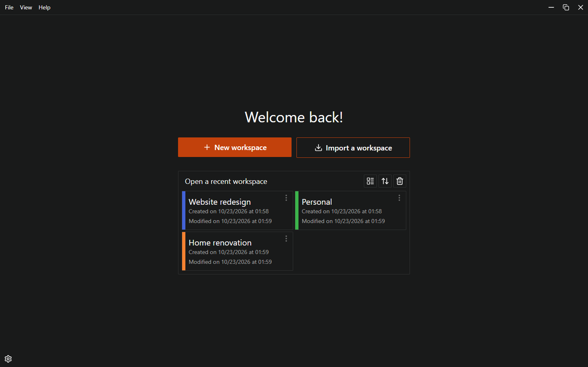
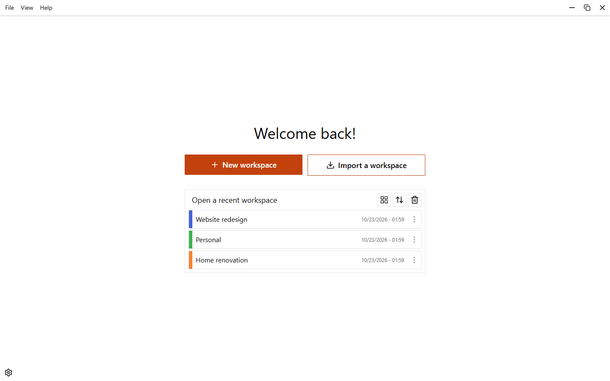
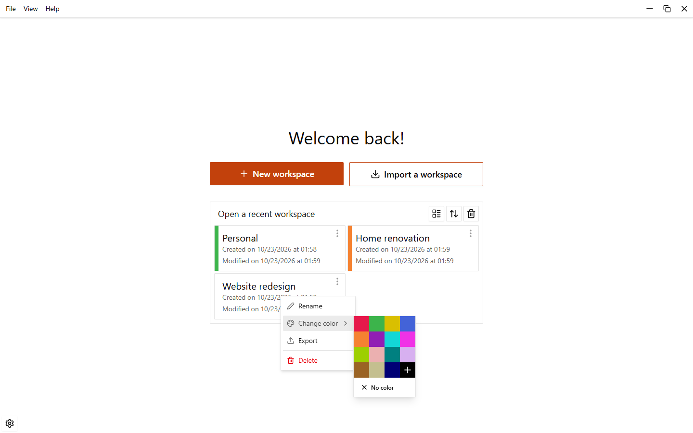

# Workspaces

A workspace is the top level of EasyTask: it holds your folders and notes. Use one workspace per project or area of your life. The home page lists them all.

{.light-only}
{.dark-only}

## The home page

The home page shows **Welcome back!**, the two buttons **New workspace** and **Import a workspace**, and the list **Open a recent workspace**.

Above the list you find three buttons:

| Button            | What it does                                                                                       |
| ----------------- | -------------------------------------------------------------------------------------------------- |
| **View as list** / **View as grid** | Switches between cards and compact rows. EasyTask remembers your choice.         |
| **Sort**          | Sorts by **Last edited**, **Creation date** or **Name**, in either direction.                      |
| **Trash**         | Opens the workspaces you deleted. See [Trash and archive](./trash-and-archive).                    |

Click a workspace to open it. A card shows its name, a colored bar on the left (if you gave it a color) and the creation and modification dates.

::: tip
If you close the app while a workspace is open, EasyTask can reopen it at the next start. Turn this on or off in **Settings > Notes and sections > Reopen the last workspace at startup**.
:::

## Create a workspace

1. Click **New workspace**, or press `Ctrl+N` on the home page.
2. Type a name in **Name**.
3. Optionally pick a color with the color button next to the name.
4. Click **Create workspace**.

Workspace names are unique: if the name is already used, the dialog shows an error and you pick another one.

## Rename, color, export, delete

Click the menu button on a workspace (it appears when you point at the card), or right-click the card.

| Entry             | What it does                                                                      |
| ----------------- | --------------------------------------------------------------------------------- |
| **Rename**        | The name becomes a text field in place. `Enter` saves, `Esc` cancels.             |
| **Change color**  | Sets or removes the colored bar of the card.                                      |
| **Export**        | Saves the workspace to a file. See below.                                         |
| **Delete**        | Asks for confirmation (**Move to trash**), then moves the workspace to the trash. |

Deleting does not destroy anything: you can restore the workspace from the home **Trash** until you empty it. Details in [Trash and archive](./trash-and-archive).

## Export a workspace

1. Open the menu of the workspace and choose **Export**. Inside a workspace you can also use **File > Export workspace…**.
2. Choose where to save. The suggested file name is `<workspace name>.easytask.json`.

The file contains the folders and notes of the workspace with their content (groups, sections, tasks), the automations of the notes and the templates. Items in the trash are left out. Use it to move a workspace to another computer or to keep a copy.

::: info
The file holds the paths of the audio files, not the audio itself.
:::

## Import a workspace

1. On the home page click **Import a workspace**.
2. Pick a `.easytask.json` file.
3. EasyTask shows an **Import** dialog with the **Workspace name** to use. Check it, change it if you want, and click **Import**.

The proposed name is already free. If a workspace (also one in the trash) has the same name, EasyTask adds a suffix such as `Website redesign (imported)`, then `(imported 2)`, and so on. If you type a name that is taken, the dialog shows an error and stays open so you can change it.

After the import a message tells you if some audio files were skipped. Audio files that cannot be found on the computer are skipped, everything else is imported.

Some limits:

- The file must be an EasyTask export, at most 50 MB.
- A file that holds only a note or a folder cannot be imported here: open a workspace and use **Import a note or folder** in the sidebar. See [Folders and notes](./folders-and-notes).

## The application menu

At the top of the window there is a text menu. On the home page it has fewer entries than inside a workspace.

| Menu        | Entries on the home page                                                              |
| ----------- | ------------------------------------------------------------------------------------- |
| **File**    | **New workspace…**, **Trash…**, **Settings…**, **Exit**                               |
| **View**    | **Theme**: light, dark or system                                                      |
| **Help**    | **Keyboard shortcuts…**, **Release notes**, **About and updates…**                    |

Press `Alt` alone or `F10` to move the focus to the menu and use it with the keyboard.
