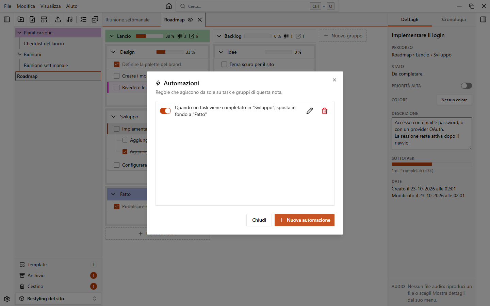
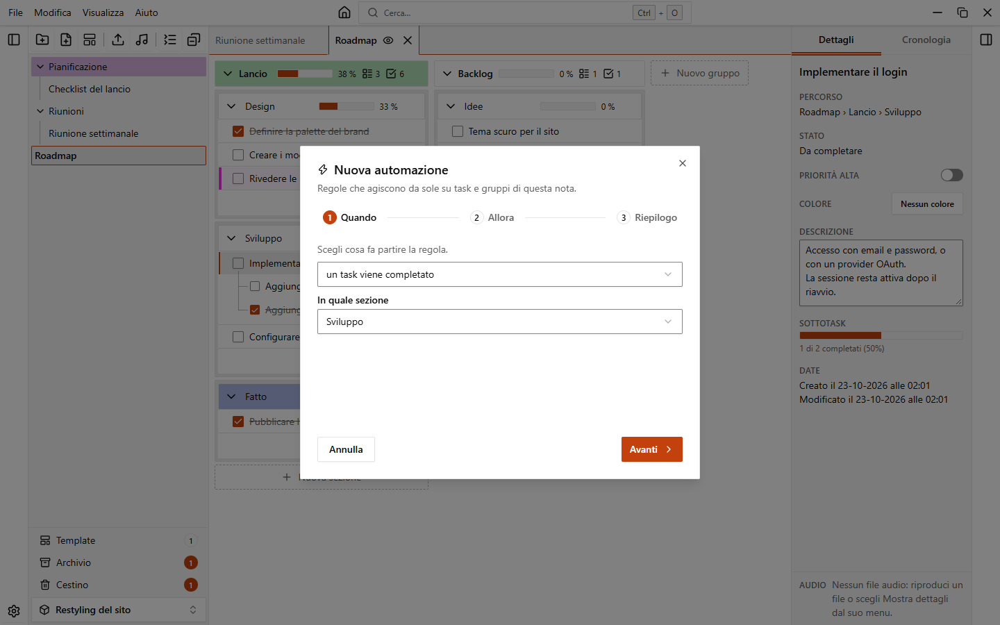

# Automazioni

Le automazioni sono regole che agiscono da sole sui task e sui gruppi di una nota. Per esempio: quando un task viene completato, sposta in **Fatto**.

Ogni regola appartiene a una nota e vede e modifica solo quella nota.

## Aprire le automazioni di una nota

1. Apri il menu della nota nella barra laterale (il pulsante **...** o il clic destro).
2. Scegli **Automazioni…**.

I menu di un gruppo e di una sezione hanno la stessa voce e aprono le automazioni della nota a cui appartengono.

La finestra elenca le regole della nota. Per creare una regola la nota deve avere almeno una sezione.

## Creare una regola

Fai clic su **Nuova automazione**. L'editor ha tre passaggi, indicati in alto: **Quando**, **Allora** e **Riepilogo**. **Avanti** e **Indietro** ti muovono tra i passaggi, e puoi anche fare clic su un passaggio.

1. **Quando**: scegli cosa fa partire la regola e dove vale: **In quale sezione** per un evento sui task (oppure **Qualsiasi sezione**), **Gruppo** per un evento sui gruppi (oppure **Qualsiasi gruppo**).
2. **Allora**: scegli cosa deve succedere. Fai clic su **Aggiungi azione** per aggiungerne altre e sul pulsante di rimozione per toglierne una.
3. **Riepilogo**: vedi la regola scritta come frase. Puoi darle un **Nome (facoltativo)** e attivare o disattivare **Regola attiva**. Fai clic su **Salva**.

Se esci dall'editor con modifiche non salvate, l'app chiede se vuoi scartarle.

## Trigger

| Trigger | Parte quando | Le azioni agiscono su |
| --- | --- | --- |
| un task viene completato | completi un task | il task |
| un task viene riaperto | riapri un task completato | il task |
| un task viene creato | aggiungi un task | il task |
| un task arriva nella sezione | un task viene spostato nella sezione da un'altra | il task |
| tutti i sottotask di un task sono completati | viene completato l'ultimo sottotask aperto di un task | il task |
| tutti i task di un gruppo sono completati | viene completato l'ultimo task aperto di un gruppo | il gruppo |
| una sezione non ha task da completare | vedi sotto | la sezione |
| una sezione ha almeno un task da completare | vedi sotto | la sezione |
| un gruppo non ha task da completare | vedi sotto | il gruppo |
| un gruppo ha almeno un task da completare | vedi sotto | il gruppo |

I trigger sui task guardano i task di primo livello di una sezione, tranne quello sui sottotask, che funziona a qualsiasi profondità. Un gruppo conta come completato quando ha almeno un task e sono tutti completati.

### Trigger a evento e trigger di stato

I primi sei trigger sono **eventi**: la regola parte una volta, nel momento in cui succede qualcosa.

Gli ultimi quattro sono **stati**: valgono finché la nota si trova in quello stato. Una sezione o un gruppo senza task conta come senza task da completare, e un task conta come finito quando è completato o quando tutti i suoi sottotask sono finiti. Poiché uno stato dura nel tempo, questi trigger permettono solo l'azione **Colore**.

::: tip
Una regola di stato non toglie il colore quando lo stato finisce. Per far tornare normale una sezione, aggiungi una seconda regola con il trigger opposto e il valore **Nessun colore**. Per esempio: "una sezione non ha task da completare" dà il verde, "una sezione ha almeno un task da completare" dà **Nessun colore**.
:::

## Azioni

Cosa puoi scegliere dipende dal trigger.

| Azione | Cosa fa | Disponibile per |
| --- | --- | --- |
| **Sposta in** | Sposta il task in una sezione della nota, **In cima** o **In fondo** | trigger sui task |
| **Segna come** | Segna il task come **Completato** o **Da fare** | trigger sui task |
| **Priorità** | **Aggiungi priorità** o **Rimuovi priorità** | trigger sui task |
| **Colore** | Dà un colore, oppure **Nessun colore** | ogni trigger |
| **Completa tutti i sottotask** | Completa ogni sottotask del task, a qualsiasi profondità | trigger sui task |
| **Sposta il gruppo** | Sposta il gruppo **In cima** o **In fondo** alla nota | trigger a evento sui gruppi |
| **Archivia il gruppo** | Archivia il gruppo | trigger a evento sui gruppi |

**Sposta in** sposta solo i task di primo livello: un sottotask resta sotto il suo task. Il colore di un'azione usa la stessa [tavolozza](./colors) del resto dell'app.

Una regola può avere più azioni, eseguite in ordine. Per esempio, "quando un task viene completato in **Sviluppo**, sposta in fondo a **Fatto** e colora di verde" è una sola regola con due azioni.

## Quando parte una regola

Le regole a evento partono quando agisci su un task della nota aperta: lo completi, lo riapri, lo crei o lo sposti. Quando una regola parte, un avviso ti dice quale ("Automazione eseguita").

Alcuni dettagli:

- Le regole vengono eseguite nell'ordine dell'elenco.
- Le azioni di una regola possono far partire altre regole, per esempio un task spostato o completato. La catena ha un limite, e una regola parte al massimo una volta per lo stesso task in una catena, quindi due regole non possono spostare un task avanti e indietro all'infinito.
- Una regola la cui sezione o il cui gruppo è stato eliminato risulta in pausa ("In pausa: sezione eliminata" o "In pausa: gruppo eliminato") e non viene eseguita.

## Annullare un'automazione

Un'automazione è un'azione a sé nella cronologia, separata da quella che l'ha fatta partire.

- Premi `Ctrl+Z` una volta per annullare l'automazione, una seconda volta per annullare ciò che hai fatto.
- Oppure fai clic su **Annulla** nell'avviso. Funziona solo finché l'automazione è la tua ultima azione. Se nel frattempo hai fatto altro, l'avviso dice "L'automazione non è più l'ultima azione: usa la cronologia per annullarla."

Vedi [Annulla e cronologia](./undo-and-history).

## Modificare, disattivare ed eliminare una regola

Nell'elenco della finestra, ogni regola ha:

- un interruttore per attivarla o disattivarla senza eliminarla;
- un pulsante di modifica, che apre la regola sul riepilogo;
- un pulsante di eliminazione, che chiede conferma.

## Note duplicate, template ed esportazioni

- **Duplica** copia le automazioni della nota. Le copie puntano alle sezioni e ai gruppi della nuova nota, quindi non agiscono mai sull'originale. Le regole che si riferiscono a qualcosa fuori dal contenuto copiato non vengono copiate.
- Un [template](./templates) non include le automazioni. Una nota creata da un template non ne ha.
- Esportando e importando un workspace, le automazioni delle sue note vengono conservate.
