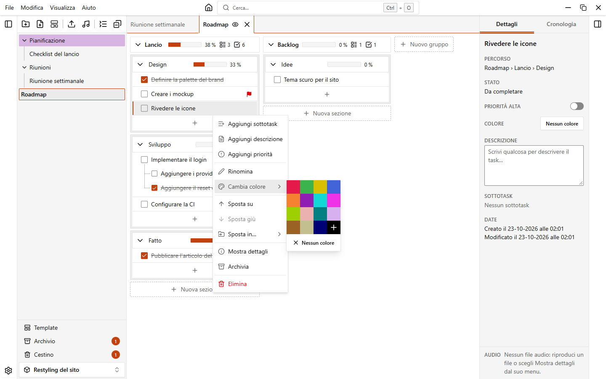

# Colori

Puoi dare un colore a workspace, cartelle, note, gruppi, sezioni e task. I colori ti aiutano a ritrovare le cose a colpo d'occhio.

## Dare un colore a un elemento

1. Apri il menu dell'elemento (il pulsante **...** o il clic destro).
2. Scegli **Cambia colore**.
3. Fai clic su un colore della tavolozza.

Questa voce c'è nel menu di ogni elemento: i workspace nella home, cartelle e note nella barra laterale, gruppi, sezioni e task nella nota. Anche il pannello dei dettagli mostra il colore dell'elemento selezionato nel campo **Colore**: fai clic per aprire la stessa tavolozza.

## La tavolozza

La tavolozza ha 15 colori:

| | | | |
| --- | --- | --- | --- |
| Rosso | Verde | Giallo | Blu |
| Arancione | Viola | Ciano | Magenta |
| Lime | Rosa | Verde acqua | Lavanda |
| Marrone | Crema | Blu notte | |

L'ultimo quadrato, con il simbolo **+**, ti fa scegliere **qualsiasi altro colore** con il selettore di colori del sistema. Il colore viene applicato quando chiudi il selettore. Un colore personalizzato appare in quel quadrato quando è selezionato.

## Togliere un colore

Apri la stessa tavolozza e fai clic su **Nessun colore**.

## Colorare il contenuto di una cartella

Il menu della cartella ha la voce **Colora contenuto**. Dà il colore della cartella a tutte le sue sottocartelle e a tutte le note che contengono. Usala quando hai cambiato il colore di una cartella e vuoi che tutto il suo contenuto sia uguale.

Puoi annullare l'operazione, vedi [Annulla e cronologia](./undo-and-history).

## Colorare più elementi insieme

Seleziona cartelle e note nella barra laterale (`Ctrl+clic` aggiunge un elemento, `Maiusc+clic` seleziona un intervallo), apri il menu di uno di essi e scegli **Colore**. La tavolozza si applica a tutta la selezione.

## I colori quando crei qualcosa

Le finestre per un nuovo workspace, una nuova cartella e una nuova nota hanno un pulsante con la tavolozza accanto al nome. Fai clic per scegliere un colore prima di creare l'elemento. Una nota creata da un template parte con il colore del template, vedi [Template](./templates).

## I colori nelle impostazioni

Apri **Impostazioni > Aspetto**.

- **Colore d'accento**: usato per pulsanti, selezioni ed evidenziazioni. Un pulsante lo reimposta.
- **Intensità dei colori**: quanto risaltano i colori di cartelle, note, gruppi e sezioni. Va dal 25% al 175% (il valore predefinito è 100%) e ha il pulsante **Reimposta**. Non cambia i colori dei task.

### Avviso di contrasto

Se il colore d'accento ha poco contrasto con lo sfondo del tema in uso, sotto l'impostazione compare un avviso: bordi, selezioni ed evidenziazioni potrebbero essere difficili da vedere. L'avviso propone il colore più vicino con contrasto sufficiente: fai clic sul pulsante **Usa #XXXXXX** (mostra il colore suggerito e il rapporto di contrasto) per applicarlo. Il controllo segue il tema che stai usando, quindi un colore può andare bene nel tema chiaro e avere un avviso in quello scuro.

## Colori impostati dalle automazioni

Un'[automazione](./automations) può colorare da sola un task, un gruppo o una sezione, per esempio una sezione che diventa verde quando tutti i suoi task sono completati. Puoi anche cambiare quel colore a mano.

::: tip
L'intensità dei colori è utile quando un colore molto forte rende il testo difficile da leggere, o quando i colori tenui si vedono poco.
:::
