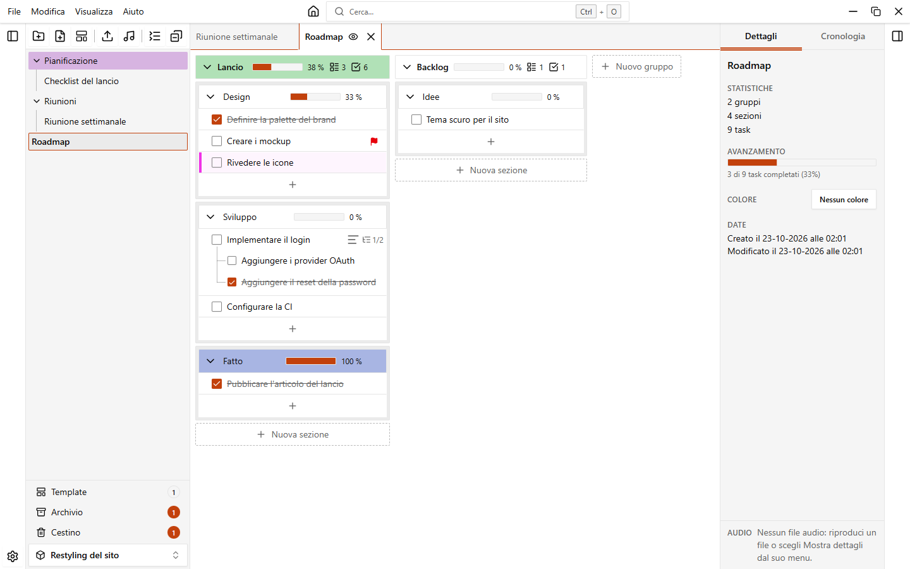
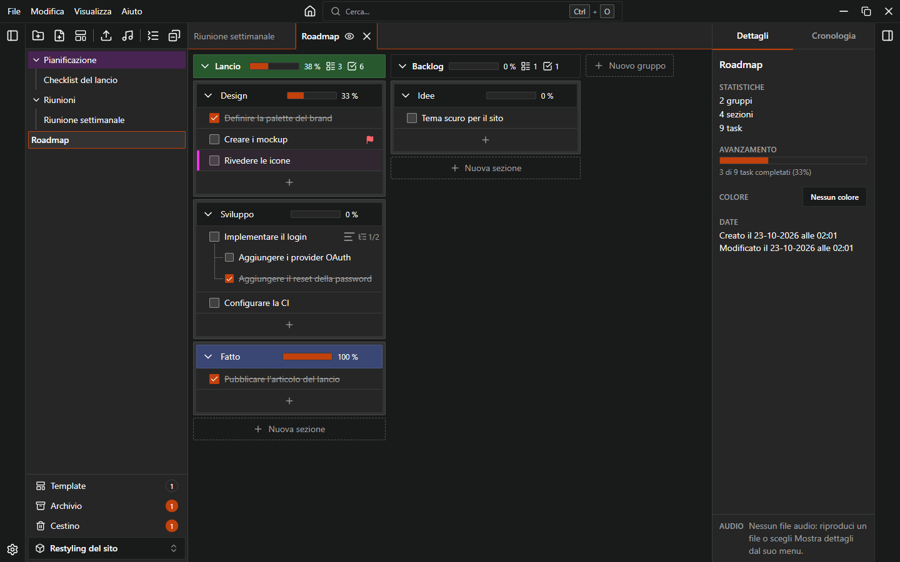
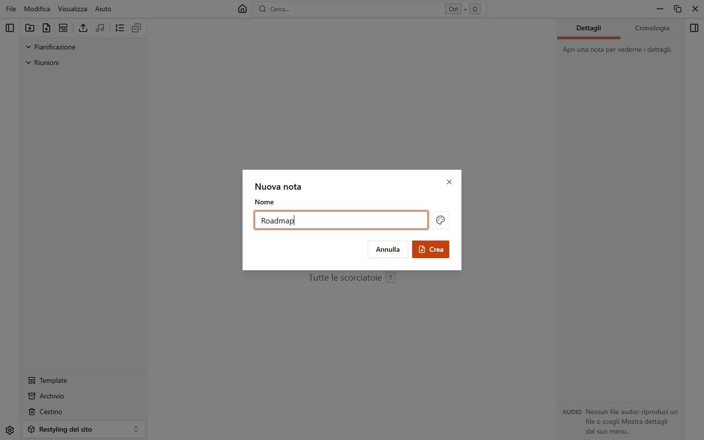
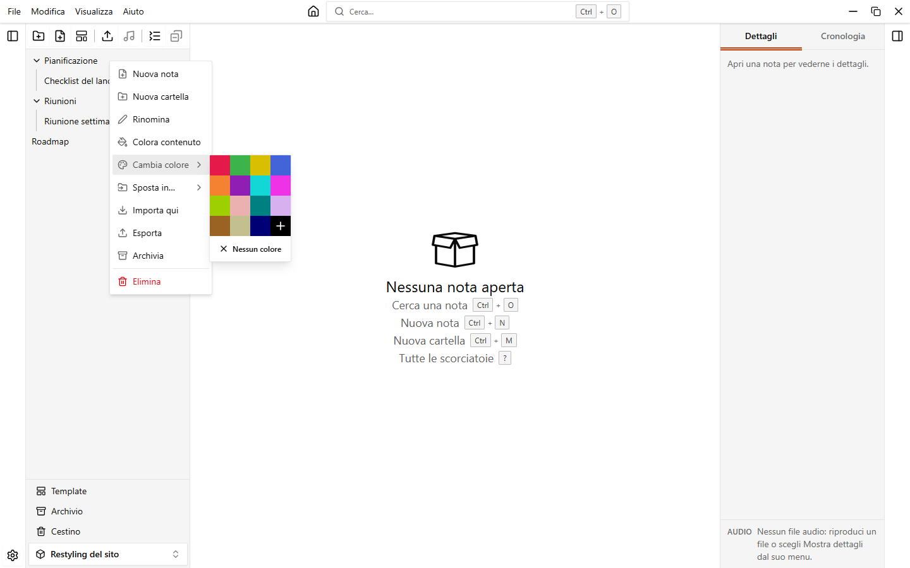
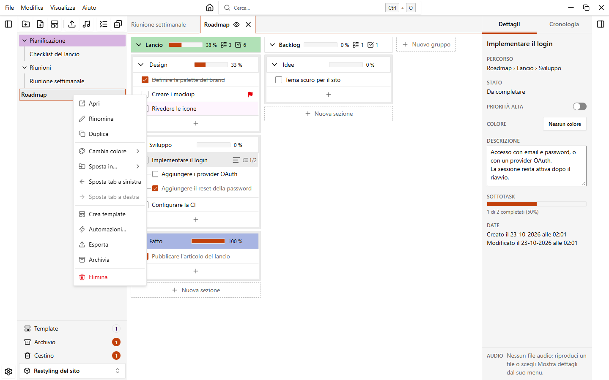
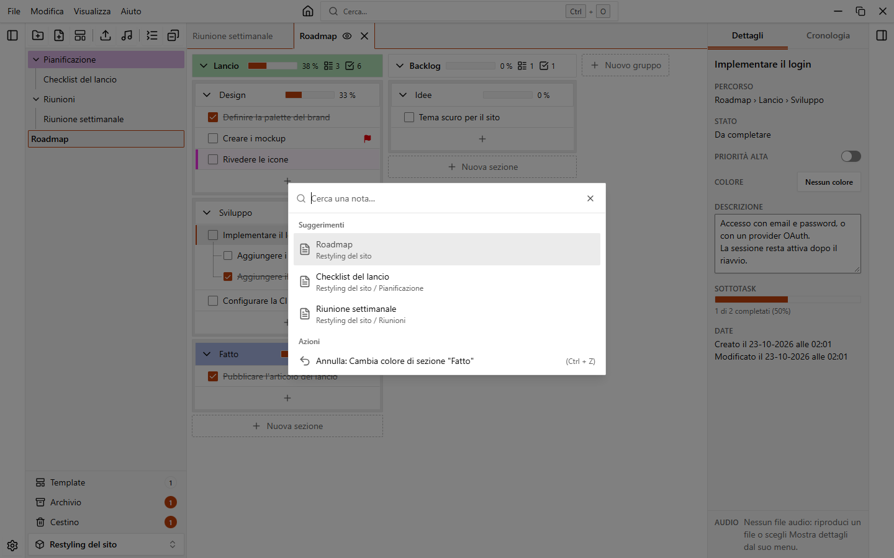

# Cartelle e note

Dentro un workspace, la barra laterale sinistra mostra un albero di cartelle e note. Le cartelle possono contenere altre cartelle, senza limiti di profondità. Le note contengono i tuoi task e si aprono in schede.

{.light-only}
{.dark-only}

## La barra laterale

In cima alla barra laterale ci sono dei pulsanti, in tre gruppi:

| Pulsante                                  | Cosa fa                                                         |
| ----------------------------------------- | --------------------------------------------------------------- |
| **Nuova cartella**, **Nuova nota**, **Nuova nota da template** | Creano elementi. Vedi sotto.               |
| **Importa una nota o una cartella**       | Importa un file `.easytask.json` di una nota o di una cartella. |
| Aggiungi file audio                       | Aggiunge file audio al primo gruppo della nota aperta. Vedi [File audio](./audio). |
| **Comprimi tutte le cartelle** / **Espandi tutte le cartelle** | Chiude o apre tutte le cartelle in un colpo. |
| **Chiudi tutte le note**                  | Chiude tutte le schede aperte.                                  |

In basso trovi **Template**, **Archivio**, **Cestino** (con un contatore di quanto contengono) e il selettore del workspace, per passare a un altro workspace. Vedi [Template](./templates) e [Cestino e archivio](./trash-and-archive).

Fai clic destro su un'area vuota dell'albero per avere le stesse azioni dei pulsanti.

### Mostrare, nascondere e ridimensionare

- `Ctrl+B` mostra o nasconde la barra laterale. Puoi usare anche **Visualizza > Barra laterale** nel menu dell'applicazione.
- Trascina il bordo della barra laterale per ridimensionarla. Con il bordo selezionato, le frecce `Sinistra` e `Destra` cambiano la larghezza e `Maiusc` rende il passo più grande.
- In una finestra stretta (sotto i 900 pixel) la barra laterale diventa un pannello sovrapposto: parte chiusa e copre la nota finché è aperta.

Per rendere le righe più piccole o più grandi vai in **Impostazioni > Aspetto > Dimensione di cartelle e note** e scegli **Compatta**, **Normale** o **Grande**.

## Creare cartelle e note

| Azione                              | Come                                                                                         |
| ----------------------------------- | -------------------------------------------------------------------------------------------- |
| Nuova nota nella radice del workspace | Pulsante **Nuova nota**, `Ctrl+N`, oppure **File > Nuova nota**                            |
| Nuova cartella nella radice         | Pulsante **Nuova cartella**, `Ctrl+M`, oppure **File > Nuova cartella**                      |
| Nuova nota o cartella dentro una cartella | Apri il menu della cartella e scegli **Nuova nota** o **Nuova cartella**               |
| Nuova nota da un template           | Pulsante **Nuova nota da template**, oppure **File > Nuova nota da template…**               |

Nella finestra **Nuova nota** scrivi un **Nome**. Puoi anche scegliere un template in **Da template** (di default **Nessun template**). Nella radice del workspace puoi dare subito un colore alla nota.

I nomi devono essere unici nella stessa cartella. Se un nome è già usato, la finestra mostra un errore.

## Rinominare, colorare e spostare

Fai clic sul pulsante del menu di una riga (compare quando ci passi sopra) oppure fai clic destro sulla riga.

| Voce                 | Cartella | Nota | Cosa fa                                                                        |
| -------------------- | :------: | :--: | ------------------------------------------------------------------------------ |
| **Nuova nota**, **Nuova cartella** | sì |  | Crea l'elemento dentro la cartella.                                          |
| **Apri**             |          | sì   | Apre la nota in una scheda.                                                    |
| **Rinomina**         | sì       | sì   | Il nome diventa un campo di testo sul posto. `Invio` salva, `Esc` annulla.     |
| **Duplica**          |          | sì   | Crea una copia chiamata per esempio `Roadmap (copia)` e la apre.               |
| **Colora contenuto** | sì       |      | Dà il colore della cartella a tutte le note e sottocartelle al suo interno.    |
| **Cambia colore**    | sì       | sì   | Imposta o toglie il colore dell'elemento.                                      |
| **Sposta in…**       | sì       | sì   | Sposta l'elemento in un'altra cartella o nella **Radice del workspace**.       |
| **Sposta tab a sinistra**, **Sposta tab a destra** | | sì | Riordina la scheda (solo se la nota è aperta).                      |
| **Crea template**    |          | sì   | Salva la nota come template. Vedi [Template](./templates).                     |
| **Automazioni…**     |          | sì   | Apre le automazioni della nota. Vedi [Automazioni](./automations).             |
| **Importa qui**      | sì       |      | Importa dentro la cartella un file di una nota o di una cartella.              |
| **Esporta**          | sì       | sì   | Salva l'elemento in un file `.easytask.json`.                                  |
| **Archivia**         | sì       | sì   | Nasconde l'elemento senza eliminarlo.                                          |
| **Elimina**          | sì       | sì   | Sposta l'elemento nel cestino, dopo conferma.                                  |

### Spostare con il trascinamento

Trascina una riga dell'albero e rilasciala dove vuoi:

- Su una nota: l'elemento va prima (metà alta) o dopo (metà bassa).
- Su una cartella: al centro della riga l'elemento va dentro la cartella; vicino al bordo alto o basso, prima o dopo.

Puoi trascinare anche con la tastiera: seleziona una riga, premi `Spazio`, spostati con le frecce, premi di nuovo `Spazio` per rilasciare, `Esc` per annullare. **Sposta in…** nel menu è un altro modo che non richiede il trascinamento.

::: info
Una cartella non si può spostare dentro se stessa o in una sua sottocartella.
:::

### Selezionare più elementi

1. `Ctrl`+clic su una riga la aggiunge alla selezione o la toglie.
2. `Maiusc`+clic seleziona tutte le righe tra l'ultima cliccata e questa.
3. Fai clic destro su una riga selezionata (o usa il suo pulsante del menu) per agire su tutta la selezione.

Il menu offre allora **Sposta**, **Colore**, **Esporta**, **Archivia** ed **Elimina** per tutti gli elementi selezionati, e puoi trascinare la selezione per spostarla in blocco. `Esc` annulla la selezione. Anche un semplice clic su una riga la annulla.

## Aprire le note in schede

Fai clic su una nota nella barra laterale per aprirla. Le note aperte compaiono come schede sopra la nota. Fai clic destro su una scheda per avere lo stesso menu della nota.

| Azione                     | Come                                                              |
| -------------------------- | ----------------------------------------------------------------- |
| Nota successiva            | `Ctrl+PageDown` o `Ctrl+Tab`                                        |
| Nota precedente            | `Ctrl+PageUp` o `Ctrl+Maiusc+Tab`                                  |
| Chiudere la nota attiva    | `Ctrl+L`, o il pulsante **Chiudi nota corrente** sulla scheda     |
| Chiudere tutte le note     | `Ctrl+T`, o il pulsante **Chiudi tutte le note** nella barra laterale |
| Riordinare le schede       | Trascina una scheda, oppure usa **Sposta tab a sinistra** / **Sposta tab a destra** |

Puoi cambiare ogni scorciatoia modificabile in **Impostazioni > Scorciatoie**. Vedi [Scorciatoie da tastiera](./shortcuts).

### Cosa si riapre all'avvio

Quando apri un workspace, EasyTask riapre le note che erano aperte e quella attiva. Il salvataggio è per ogni workspace. Per disattivarlo vai in **Impostazioni > Note e sezioni** e spegni **Riapri le note all'avvio**. Nella stessa pagina c'è **Riapri l'ultimo workspace all'avvio**.

## Cercare una nota

Premi `Ctrl+O`, oppure fai clic sul campo **Cerca…** in alto nella finestra, poi scrivi parte del nome di una nota. L'elenco mostra ogni risultato con il percorso della sua cartella. Scegline uno per aprirlo.

Lo stesso elenco propone anche l'ultima azione che puoi annullare o ripetere. Vedi [Annulla e cronologia](./undo-and-history).
