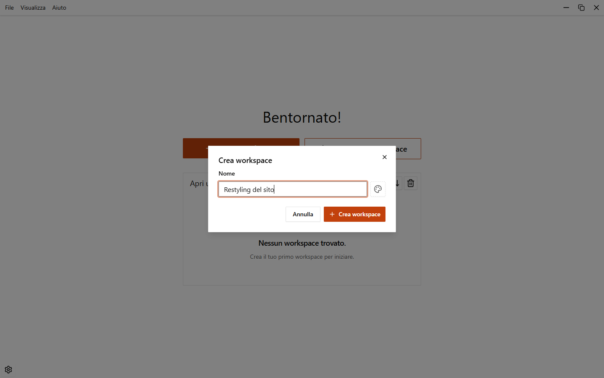
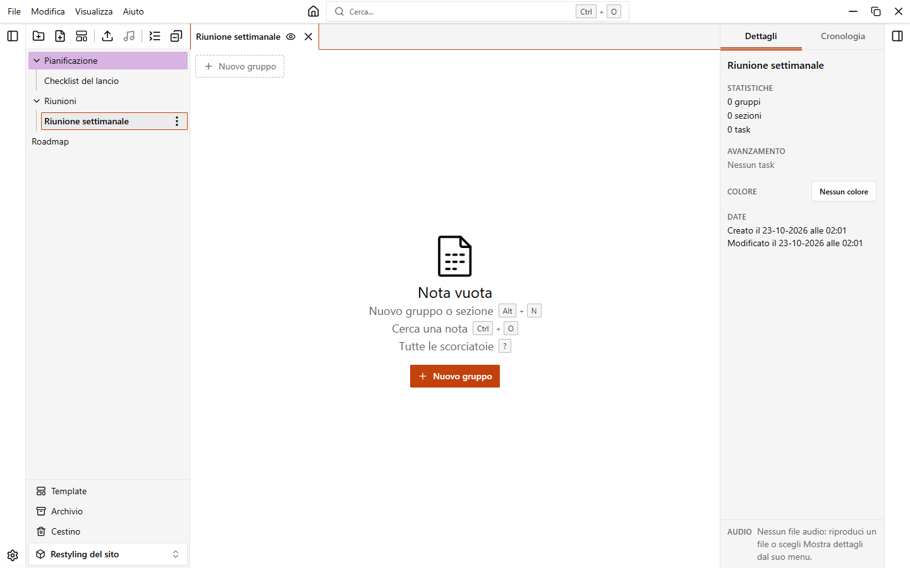

# Primi passi

Questa guida ti porta da un'app vuota a una nota con qualche task.

## 1. Crea un workspace

Nella home clicca **Nuovo workspace** (oppure premi `Ctrl+N`). Scrivi un nome nella finestra **Crea workspace** e conferma.

Apri il workspace dall'elenco nella home.

## 2. Crea una cartella e una nota

Nella barra laterale clicca **Nuova cartella** e dai un nome. Le cartelle sono facoltative: puoi anche creare le note direttamente nel workspace.

Per creare una nota clicca **Nuova nota** (oppure premi `Ctrl+N`). Nella finestra **Nuova nota** scrivi un nome e clicca **Crea**. Puoi anche partire da un template: vedi [Template](./templates).

La nota si apre in una scheda. Le note aperte restano nella barra delle schede.

## 3. Aggiungi un gruppo e una sezione

Una nota nuova è vuota. Clicca **Nuovo gruppo** (oppure premi `Alt+N`) per aggiungere un gruppo. Un gruppo contiene task, aggiunti con il suo pulsante **Nuovo task**, e sezioni, aggiunte dal menu del gruppo con **Nuova sezione**.

Gruppi e sezioni possono restare senza nome. Per dare un nome, clicca sul nome e scrivi.

## 4. Aggiungi task e sottotask

In una sezione clicca **Aggiungi task** e scrivi il testo del task. Conferma con `Invio`.

Per aggiungere un sottotask apri il menu di un task e scegli **Aggiungi sottotask**. I sottotask possono avere a loro volta dei sottotask.

## 5. Completa un task

Clicca la casella di un task per completarlo. Un task con sottotask mostra quanti sono completati, e sezioni e gruppi possono mostrare una barra di avanzamento (vedi [Impostazioni](./settings)). Per nascondere i task completati premi `Ctrl+Shift+H`.

## 6. Apri il pannello dei dettagli

Seleziona un task e apri il pannello dei dettagli con `Ctrl+Shift+B`, oppure da **Visualizza > Pannello dei dettagli** nel menu. Il pannello mostra i dettagli del task e i suoi sottotask.

{.light-only}
{.dark-only}

## Prossimi passi

- [Workspace](./workspaces)
- [Cartelle e note](./folders-and-notes)
- [Gruppi, sezioni e task](./groups-sections-tasks)
- [Colori](./colors)
- [Automazioni](./automations)
- [Template](./templates)
- [Cestino e archivio](./trash-and-archive)
- [Annulla e cronologia](./undo-and-history)
- [Audio](./audio)
- [Scorciatoie da tastiera](./shortcuts)
- [Impostazioni](./settings)
- [Dati e backup](./data-and-backups)
- [Aggiornamenti](./updates)
- [Risoluzione dei problemi](./troubleshooting)
