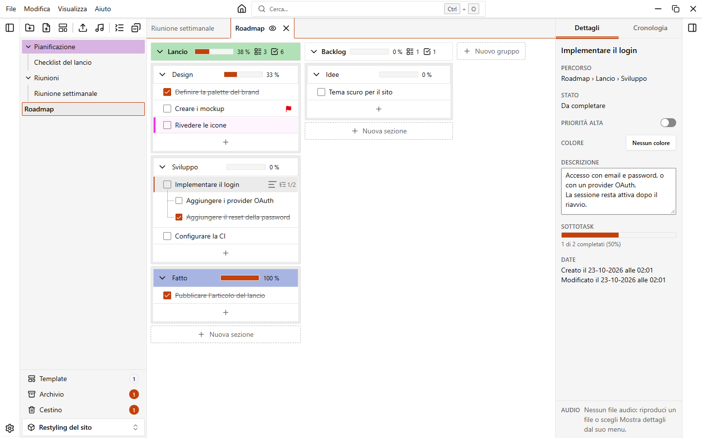
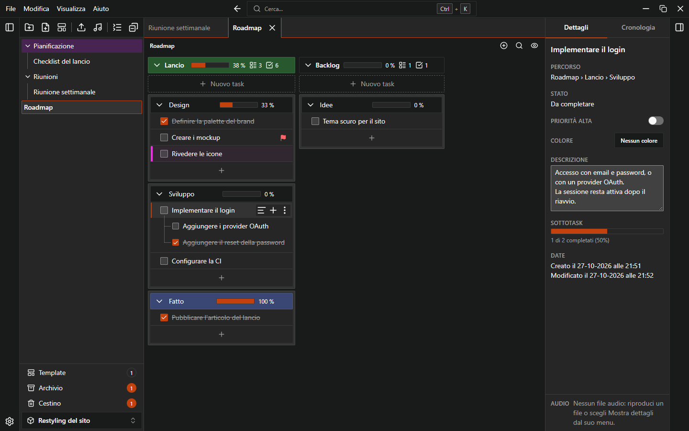
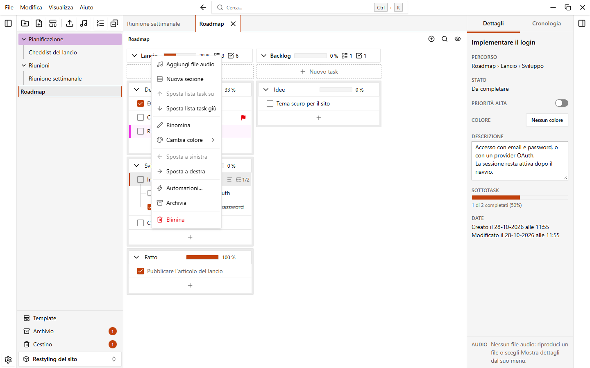
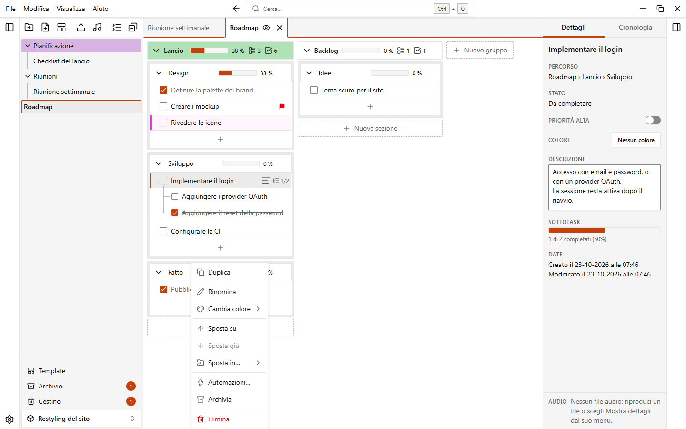
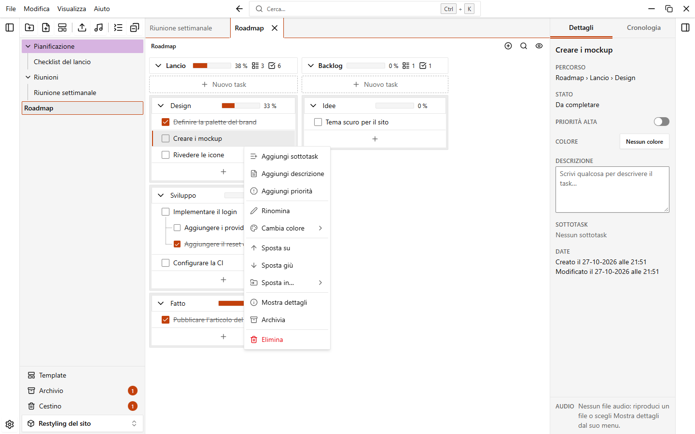
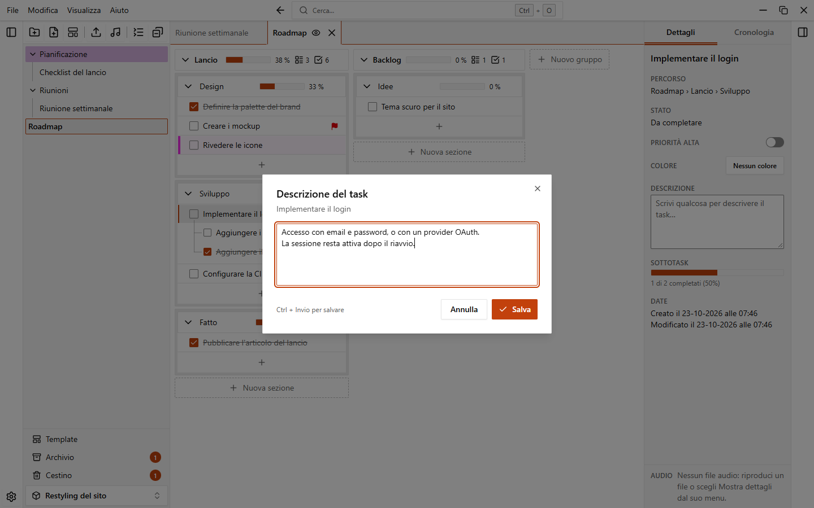

# Gruppi, sezioni e task

Il contenuto di una nota è organizzato su tre livelli. Una nota contiene dei **gruppi**, affiancati come colonne. Un gruppo contiene delle **sezioni**, impilate nella colonna. Una sezione contiene dei **task**, e un task può avere dei **sottotask**, annidati quanto serve.

{.light-only}
{.dark-only}

## Gruppi e sezioni

### Aggiungerli

- Fai clic su **Nuovo gruppo**, oppure premi `Alt+N`, scrivi un nome e premi `Invio`. `Esc` chiude il campo.
- Dentro un gruppo fai clic su **Nuova sezione**, scrivi un titolo e premi `Invio`.

Il nome è facoltativo: premi `Invio` su un campo vuoto e il gruppo o la sezione viene creato senza nome. EasyTask mostra allora **Gruppo 1**, **Gruppo 2**… o **Sezione senza titolo** in grigio. Puoi nascondere queste etichette con **Impostazioni > Note e sezioni > Mostra il nome dei gruppi e delle sezioni senza nome**.

### Rinominare, colorare e gestire

Fai clic sul nome per rinominarlo sul posto (`Invio` salva, `Esc` annulla), oppure apri il menu del gruppo o della sezione con il suo pulsante o con il clic destro.

Il clic destro sull'area vuota della nota (fuori da gruppi, sezioni e task) apre un piccolo menu con **Nuovo gruppo** e **Nascondi / Mostra task completati**.

| Voce                                   | Gruppo | Sezione | Cosa fa                                                          |
| -------------------------------------- | :----: | :-----: | ---------------------------------------------------------------- |
| **Aggiungi file audio**                | sì     |         | Aggiunge file audio al gruppo. Vedi [File audio](./audio).       |
| **Duplica**                            |        | sì      | Copia la sezione, con i suoi task, subito dopo l'originale.      |
| **Rinomina**                           | sì     | sì      | Modifica il nome.                                                |
| **Cambia colore**                      | sì     | sì      | Imposta o toglie il colore.                                      |
| **Sposta a sinistra**, **Sposta a destra** | sì |         | Sposta il gruppo di un passo nella riga.                         |
| **Sposta su**, **Sposta giù**          |        | sì      | Sposta la sezione di un passo nel suo gruppo.                    |
| **Sposta in…**                         |        | sì      | Sposta la sezione in fondo a un altro gruppo, o in un **Nuovo gruppo**. |
| **Automazioni…**                       | sì     | sì      | Apre le automazioni della nota. Vedi [Automazioni](./automations). |
| **Archivia**                           | sì     | sì      | Lo nasconde senza eliminarlo. Vedi [Cestino e archivio](./trash-and-archive). |
| **Elimina**                            | sì     | sì      | Lo sposta nel cestino.                                           |

Puoi spostare gli elementi anche trascinandoli:

- Trascina un gruppo dalla sua intestazione per riordinare i gruppi.
- Trascina una sezione su un altro gruppo, o tra due sezioni, per spostarla. Rilasciala sull'area **Nuovo gruppo** al bordo per farne un gruppo a sé.

### Comprimere, contatori e barre d'avanzamento

Ogni gruppo e ogni sezione ha un pulsante per comprimerlo (**Comprimi gruppo**, **Comprimi sezione**). Un gruppo può mostrare quante sezioni, task e file audio contiene. Gruppi e sezioni possono mostrare anche una barra d'avanzamento con la percentuale di task completati (per un gruppo contano tutti i task e i sottotask). Scegli cosa mostrare in **Impostazioni > Note e sezioni**: **Mostra barra d'avanzamento nelle sezioni**, **Mostra barra d'avanzamento nei gruppi**, **Mostra numero di sezioni**, **Mostra numero di task**, **Mostra numero di file audio**. L'opzione **Linee tra i gruppi** disegna una sottile linea guida tra le colonne.

### Ridimensionare un gruppo

Trascina il bordo destro di un gruppo per allargarlo o restringerlo. Da tastiera, porta il focus sul bordo e usa `Sinistra` e `Destra` (con `Maiusc` i passi sono più grandi), `Home` per la larghezza minima e `Fine` per quella massima. Con un doppio clic sul bordo torni alla larghezza automatica. La barra di avanzamento del gruppo sparisce quando il gruppo è troppo stretto per mostrarla.

## Task e sottotask

### Aggiungere un task

1. In fondo a una sezione fai clic sul pulsante **+** (**Aggiungi task**).
2. Scrivi il testo in **Nuovo task…** e conferma con `Invio` o con il pulsante di aggiunta. `Esc` chiude il campo.

I nuovi task vanno in fondo alla sezione. Per metterli in cima scegli **In cima** in **Impostazioni > Note e sezioni > Posizione dei nuovi task**.

### Aggiungere un sottotask

Passa il mouse su un task e fai clic su **Aggiungi sottotask**, oppure scegli la voce dal menu del task. Scrivi il testo e premi `Invio`: il campo resta aperto per il sottotask successivo. `Esc` lo chiude. I sottotask possono avere altri sottotask, senza limiti. Il task mostra quanti sottotask sono completati (per esempio `1/3`) se **Mostra sottotask completati** è attivo.

### Modificare e completare

- Spunta la casella per completare un task, togli la spunta per riaprirlo.
- Fai clic sul testo per modificarlo. `Invio` salva, `Esc` annulla. Se preferisci evitare modifiche accidentali, disattiva **Rinomina cliccando sul nome**: userai **Rinomina** nel menu o `Invio` sul nome.

### Priorità, descrizione e colore

Apri il menu del task (pulsante del menu o clic destro):

| Voce                                         | Cosa fa                                                              |
| -------------------------------------------- | -------------------------------------------------------------------- |
| **Aggiungi sottotask**                       | Aggiunge un sottotask.                                               |
| **Aggiungi descrizione** / **Rimuovi descrizione** | Apre una finestra dove scrivi la **Descrizione**. `Maiusc+Invio` va a capo, `Ctrl+Invio` salva. |
| **Aggiungi priorità** / **Rimuovi priorità** | Segna il task come ad alta priorità. Sul task compare una bandierina. |
| **Rinomina**                                 | Modifica il testo.                                                   |
| **Cambia colore**                            | Colora il task con una barra laterale (e uno sfondo leggero, se lo vuoi). |
| **Sposta su**, **Sposta giù**                | Sposta il task di un passo tra i suoi fratelli.                      |
| **Sposta in…**                               | Sposta il task in un'altra sezione, o sotto un altro task come sottotask. |
| **Mostra dettagli**                          | Seleziona il task nel pannello dei dettagli.                         |
| **Archivia**, **Elimina**                    | Lo nascondono o lo spostano nel cestino, con i suoi sottotask.       |

Un task con una descrizione mostra una piccola icona: fai clic per leggerla. L'aspetto dei task dipende da **Densità dei task** (**Compatta**, **Normale**, **Ampia**) e da **Sfondo colorato dei task**.

### Spostare i task

Trascina un task dalla sua riga. Rilascialo:

- tra due task, per riordinarli;
- al centro di un task, per renderlo un sottotask di quel task;
- su una sezione, per farne l'ultimo task di quella sezione.

**Sposta su**, **Sposta giù** e **Sposta in…** nel menu fanno lo stesso senza trascinare.

## Nascondere i task completati

Premi `Ctrl+Maiusc+H`, usa il pulsante a forma di occhio nella barra del percorso sopra i gruppi, oppure scegli **Visualizza > Nascondi task completati**. I task completati e i loro sottotask spariscono, e ogni sezione indica quanti sono nascosti. Un task completato che ha ancora un sottotask aperto resta visibile, così il lavoro aperto non si perde. Non viene eliminato nulla: premi di nuovo la scorciatoia per rivederli. Per partire con i task nascosti usa **Impostazioni > Note e sezioni > Nascondi task completati**.

## Il pannello dei dettagli

Il pannello a destra ha due schede. Aprilo o chiudilo con `Ctrl+Maiusc+B` o **Visualizza > Pannello dei dettagli**.

**Dettagli** mostra:

- per un task selezionato (fai clic su di esso): il percorso, lo stato, un interruttore per **Priorità alta**, il **Colore**, la **Descrizione** (modificabile, con **Salva** e **Annulla**), l'avanzamento dei sottotask e le date;
- per la nota, quando nessun task è selezionato: il numero di gruppi, sezioni e task, l'avanzamento complessivo, il colore e le date.

**Cronologia** elenca le azioni che puoi annullare e ripetere. Vedi [Annulla e cronologia](./undo-and-history).

## Finestre piccole

Sotto i 900 pixel di larghezza, la barra laterale e il pannello dei dettagli diventano pannelli sovrapposti: partono chiusi e coprono la nota finché sono aperti. Aprili con `Ctrl+B` e `Ctrl+Maiusc+B`.

## Controllo ortografico

EasyTask sottolinea le parole sbagliate mentre scrivi. Per disattivarlo vai in **Impostazioni > Note e sezioni > Controllo ortografico**.
