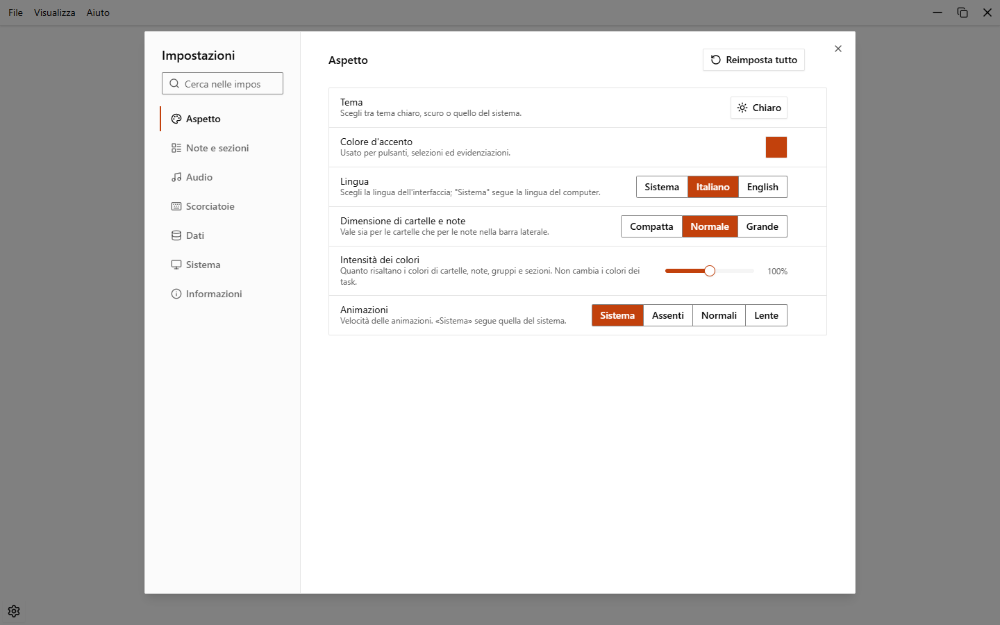
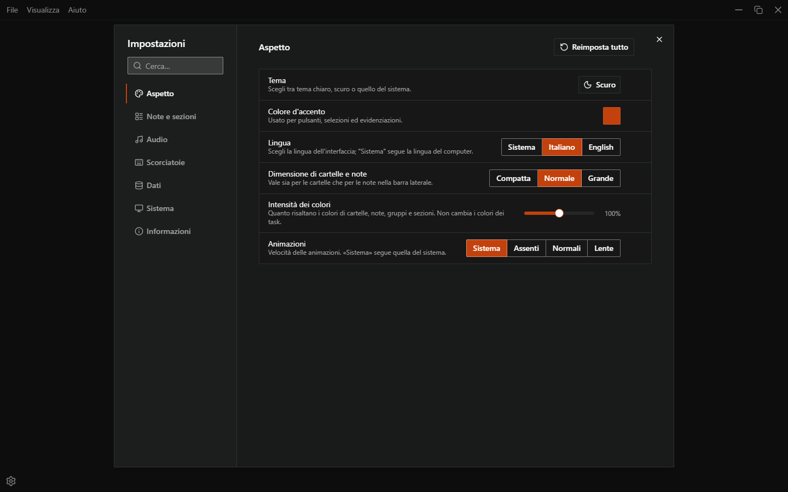
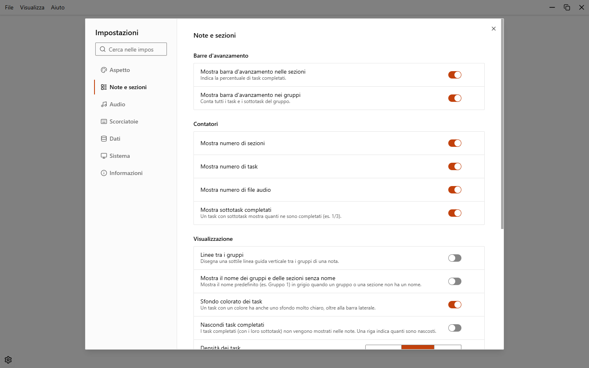
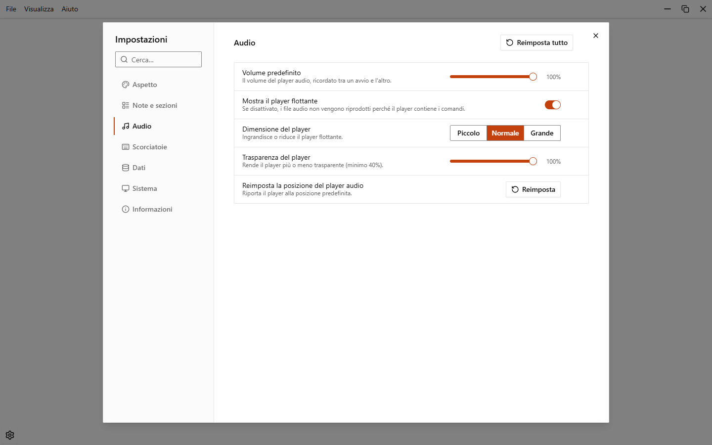
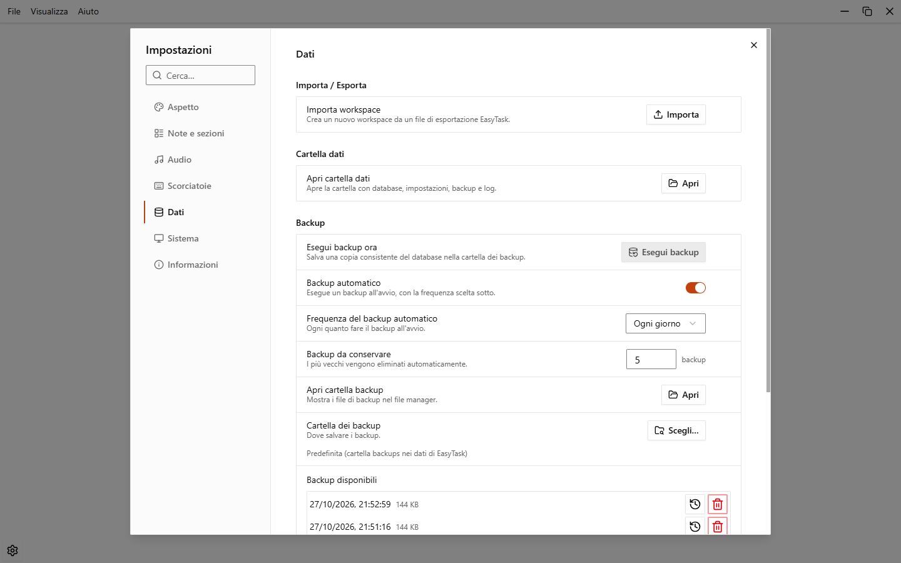
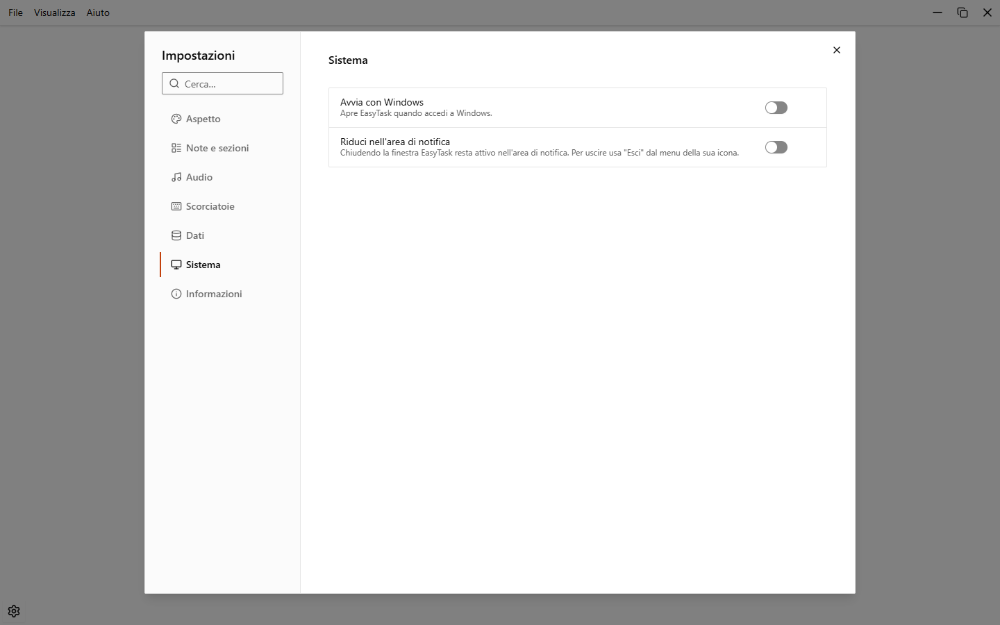
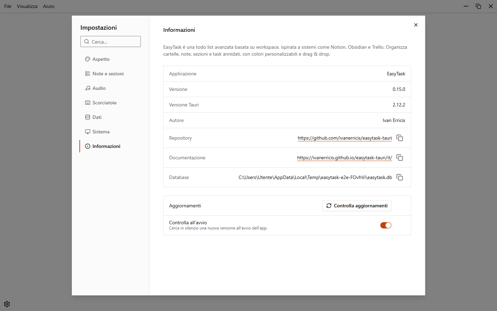

# Impostazioni

Apri le impostazioni dal menu dell'applicazione (**File > Impostazioni…**). Le opzioni sono divise in sette categorie. Le modifiche si applicano subito e vengono salvate in automatico.

## Cercare nelle impostazioni

Scrivi nel campo **Cerca nelle impostazioni…** in alto a sinistra per trovare un'opzione dal nome o dalla descrizione. La ricerca guarda in tutte le categorie e mostra solo le righe che corrispondono. Gli accenti non contano.

Premi `Esc`, clicca la X o scegli una categoria per cancellare la ricerca.

## Pulsanti di reimpostazione

- Una riga diversa dal valore predefinito mostra accanto una piccola freccia di ripristino (colore d'accento, intensità dei colori, ogni scorciatoia).
- **Reimposta tutto**, in alto in una categoria, riporta l'intera categoria ai valori predefiniti. C'è in Aspetto, Audio e Scorciatoie. Aspetto e Scorciatoie chiedono prima conferma. I tuoi dati non vengono mai toccati.

## Aspetto

{.light-only}
{.dark-only}

| Opzione | Scelte | Predefinito |
| --- | --- | --- |
| Tema | Chiaro, Scuro, Sistema | Sistema |
| Colore d'accento | Qualsiasi colore | Arancione (`#c2410c`) |
| Lingua | Sistema, Italiano, English | Sistema |
| Dimensione di cartelle e note | Compatta, Normale, Grande | Normale |
| Intensità dei colori | Cursore da 25% a 175% | 100% |
| Animazioni | Sistema, Assenti, Normali, Lente | Sistema |

Se il colore d'accento ha poco contrasto con lo sfondo, EasyTask ti avvisa e suggerisce un colore simile più visibile. L'intensità dei colori cambia cartelle, note, gruppi e sezioni, non i colori dei task.

## Note e sezioni

| Opzione | Scelte | Predefinito |
| --- | --- | --- |
| **Barre d'avanzamento**: Mostra barra d'avanzamento nelle sezioni | Sì / No | Sì |
| Mostra barra d'avanzamento nei gruppi | Sì / No | Sì |
| **Contatori**: Mostra numero di sezioni | Sì / No | Sì |
| Mostra numero di task | Sì / No | Sì |
| Mostra numero di file audio | Sì / No | Sì |
| Mostra sottotask completati | Sì / No | Sì |
| **Visualizzazione**: Linee tra i gruppi | Sì / No | No |
| Mostra il nome dei gruppi e delle sezioni senza nome | Sì / No | No |
| Sfondo colorato dei task | Sì / No | Sì |
| Nascondi task completati | Sì / No | No |
| Densità dei task | Compatta, Normale, Ampia | Normale |
| **Comportamento**: Rinomina cliccando sul nome | Sì / No | Sì |
| Continua ad aggiungere task (il campo resta aperto dopo aver creato un task) | Sì / No | Sì |
| Linea per inserire un task (una linea con un + tra due task; con Continua ad aggiungere task il campo si sposta sotto il nuovo task) | Sì / No | Sì |
| Posizione dei nuovi task | In cima, In fondo | In fondo |
| Controllo ortografico | Sì / No | Sì |
| Conferma l'eliminazione solo se c'è contenuto (note, sezioni e gruppi: se attiva, quelli vuoti vanno subito nel cestino con **Annulla**, gli altri chiedono conferma; se disattivata non chiede mai. Cartelle, workspace, task e selezioni multiple chiedono sempre) | Sì / No | Sì |
| **All'avvio**: Riapri l'ultimo workspace all'avvio | Sì / No | No |
| Riapri le note all'avvio | Sì / No | Sì |

## Audio

| Opzione | Scelte | Predefinito |
| --- | --- | --- |
| Volume predefinito | Cursore da 0% a 100% | 100% |
| Mostra il player flottante | Sì / No | Sì |
| Dimensione del player | Piccolo, Normale, Grande | Normale |
| Trasparenza del player | Cursore da 40% a 100% di opacità | 100% |
| Reimposta la posizione del player audio | Pulsante | |

Quando **Mostra il player flottante** è disattivato, i file audio non vengono riprodotti. Vedi [File audio](./audio).

## Scorciatoie

Elenca tutte le scorciatoie che puoi cambiare, raggruppate come nella finestra delle scorciatoie. Vedi [Scorciatoie da tastiera](./shortcuts#cambiare-una-scorciatoia).

## Dati

| Sezione | Opzione | Scelte | Predefinito |
| --- | --- | --- | --- |
| Importa / Esporta | Importa workspace | Pulsante | |
| Importa / Esporta | Esporta workspace corrente | Pulsante (solo dentro un workspace) | |
| Cartella dati | Apri cartella dati | Pulsante | |
| Backup | Esegui backup ora | Pulsante | |
| Backup | Backup automatico | Sì / No | Sì |
| Backup | Frequenza del backup automatico | Ogni giorno, Ogni settimana, Ogni mese | Ogni giorno |
| Backup | Backup da conservare | Da 1 a 100 | 5 |
| Backup | Apri cartella backup | Pulsante | |
| Backup | Cartella dei backup | **Scegli…** oppure **Usa la predefinita** | Predefinita (`backups` nella cartella dati) |
| Cestino | Svuota automaticamente il cestino | Mai, Dopo 7 giorni, Dopo 30 giorni, Dopo 90 giorni | Mai |
| Cronologia | Azioni annullabili | 25, 50, 100, 200, 500 | 50 |

Backup, ripristino e cartella dati sono spiegati in [Dati e backup](./data-and-backups). Il limite della cronologia è spiegato in [Annulla e cronologia](./undo-and-history).

## Sistema

| Opzione | Cosa fa | Predefinito |
| --- | --- | --- |
| Avvia con Windows | Apre EasyTask quando accedi a Windows | No |
| Riduci nell'area di notifica | Chiudendo la finestra EasyTask resta attivo nell'area di notifica. Per uscire usa **Esci** dal menu della sua icona. Il menu dell'icona ha anche **Apri EasyTask** | No |
| Ricorda posizione e dimensione della finestra | Al prossimo avvio la finestra torna dove l'hai lasciata. Non disponibile nella versione portatile | Sì |
| Tieni la finestra in primo piano | EasyTask resta sopra le altre finestre; si applica subito e viene ricordato all'avvio | No |

## Informazioni

Mostra la versione, l'autore e il repository, e il percorso del database. Ha anche **Controlla aggiornamenti** e l'interruttore **Controlla all'avvio** (attivo di default). Vedi [Aggiornamenti](./updates).
