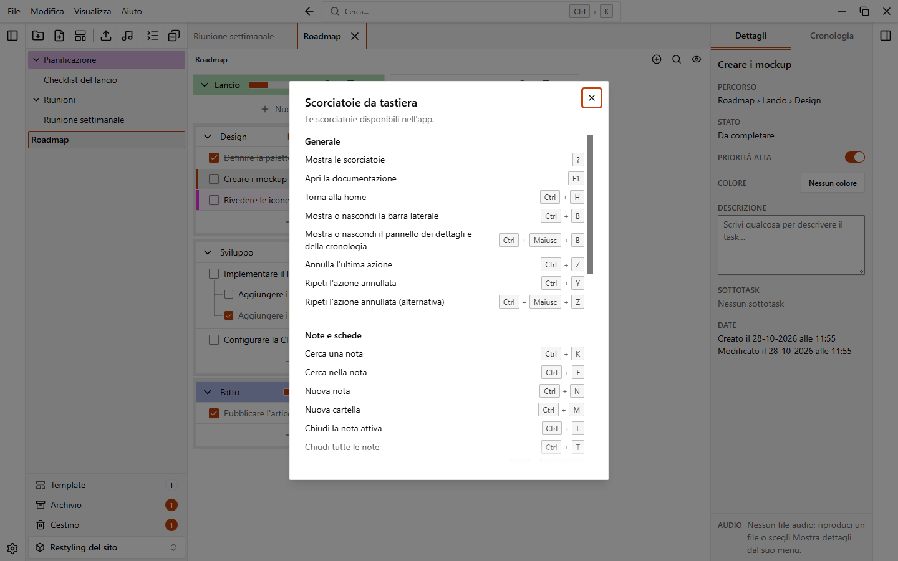
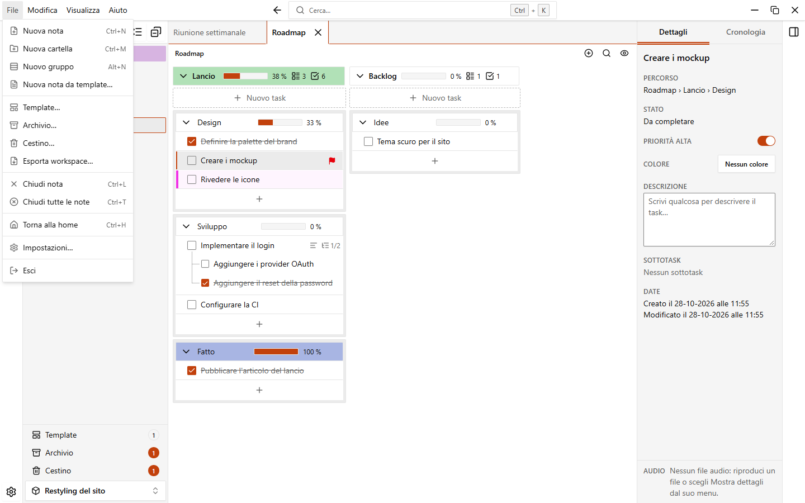
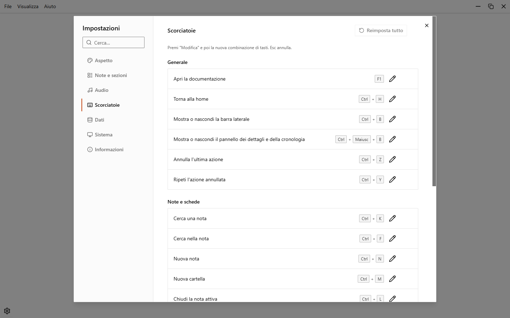

# Scorciatoie da tastiera

EasyTask ha scorciatoie da tastiera per le azioni più comuni. Premi `?` per vedere l'elenco completo, oppure scegli **Aiuto > Scorciatoie da tastiera…** nel menu dell'applicazione.

Le scorciatoie funzionano quando non stai scrivendo, con alcune eccezioni: quelle per schede, barre laterali, ricerca, torna alla home, task completati e nuovo gruppo funzionano anche dentro i campi di testo. `Ctrl+Z` e `Ctrl+Y` no, perché il campo ha il suo annulla.

## Generale

| Azione | Scorciatoia | Modificabile |
| --- | --- | --- |
| Mostra le scorciatoie | `?` | No |
| Apri la documentazione | `F1` | Sì |
| Torna alla home | `Ctrl+H` | Sì |
| Mostra o nascondi la barra laterale | `Ctrl+B` | Sì |
| Mostra o nascondi il pannello dei dettagli e della cronologia | `Ctrl+Maiusc+B` | Sì |
| Annulla l'ultima azione | `Ctrl+Z` | Sì |
| Ripeti l'azione annullata | `Ctrl+Y` | Sì |
| Ripeti l'azione annullata (alternativa) | `Ctrl+Maiusc+Z` | No |

## Note e schede

| Azione | Scorciatoia | Modificabile |
| --- | --- | --- |
| Cerca una nota | `Ctrl+K` | Sì |
| Cerca nella nota | `Ctrl+F` | Sì |
| Nuova nota | `Ctrl+N` | Sì |
| Nuova cartella | `Ctrl+M` | Sì |
| Chiudi la nota attiva | `Ctrl+L` | Sì |
| Chiudi tutte le note | `Ctrl+T` | Sì |
| Vai alla nota aperta successiva | `Ctrl+PageDown` | Sì |
| Vai alla nota aperta precedente | `Ctrl+PageUp` | Sì |
| Vai alla nota aperta successiva (alternativa) | `Ctrl+Tab` | No |
| Vai alla nota aperta precedente (alternativa) | `Ctrl+Maiusc+Tab` | No |
| Nascondi o mostra task completati | `Ctrl+Maiusc+H` | Sì |
| Riproduci o metti in pausa l'audio | `Alt+P` | Sì |

## Gruppi, sezioni e task

| Azione | Scorciatoia | Modificabile |
| --- | --- | --- |
| Nuovo gruppo o sezione | `Alt+N` | Sì |
| Conferma la modifica di nome gruppo, sezione o task | `Invio` | No |
| Annulla la rinomina del gruppo o chiudi il nuovo sottotask | `Esc` | No |
| Vai a capo nella descrizione di un task | `Maiusc+Invio` | No |

## Task da tastiera

Questi tasti funzionano quando una riga di task ha il focus (clicca un task o raggiungilo con `Tab`). Non funzionano mentre scrivi in un campo e, con `Ctrl` o `Cmd`, lasciano il posto alle altre scorciatoie, tranne `Ctrl+Spazio` (`Cmd+Spazio` su macOS). Non si possono cambiare.

| Azione | Scorciatoia |
| --- | --- |
| Task precedente o successivo della lista | `↑` / `↓` |
| Primo o ultimo task della lista | `Home` / `End` |
| Aprire i sottotask, poi andare al primo sottotask | `→` |
| Chiudere i sottotask, poi andare al task padre | `←` |
| Completare o riaprire il task | `Spazio` |
| Modificare il testo del task | `Invio` |
| Aprire il menu del task | `Shift+F10` o il tasto menu |
| Spostare il task di un passo su o giù | `Alt+↑` / `Alt+↓` |
| Estendere la selezione al task precedente o successivo | `Maiusc+↑` / `Maiusc+↓` |
| Estendere la selezione al primo o all'ultimo task | `Maiusc+Home` / `Maiusc+Fine` |
| Aggiungere il task alla selezione, o toglierlo | `Ctrl+Spazio` (`Cmd+Spazio` su macOS) |

Le frecce restano dentro la lista della sezione (o dei task diretti di un gruppo): non saltano alla sezione successiva. Dopo `Alt+↑` o `Alt+↓` il focus resta sul task e uno screen reader annuncia la nuova posizione ("Spostato in posizione 2 di 5"). I tasti di selezione non cambiano il task mostrato nel pannello dei dettagli. Vedi [Usare la tastiera](./groups-sections-tasks.md#usare-la-tastiera).
## Pagina iniziale

| Azione | Scorciatoia | Modificabile |
| --- | --- | --- |
| Nuovo workspace | `Ctrl+N` | Sì |

`Ctrl+N` è **Nuova nota** dentro un workspace e **Nuovo workspace** nella pagina iniziale.

## Il menu dell'applicazione

La barra dei menu in alto ha **File**, **Modifica**, **Visualizza** e **Aiuto**. Premi e rilascia `Alt` da solo, oppure premi `F10`, per spostare lì il focus, poi usa le frecce. Premi di nuovo `Alt` per tornare dov'eri. Le voci del menu mostrano la loro scorciatoia.

## Cambiare una scorciatoia

1. Apri **Impostazioni > Scorciatoie**.
2. Clicca la matita accanto all'azione.
3. Premi la nuova combinazione di tasti. `Esc` annulla.
4. Se la combinazione è già usata, EasyTask ti dice da quale azione. Scegline un'altra.

Una scorciatoia deve usare `Ctrl` o `Alt`, tranne i tasti funzione come `F5`.

Un'azione con una scorciatoia personalizzata mostra un pulsante di ripristino. Cliccalo per tornare al valore predefinito di quell'azione. **Reimposta tutto**, in alto, riporta tutte le scorciatoie ai valori predefiniti.

In **Impostazioni > Scorciatoie** compaiono solo le scorciatoie segnate "Sì" qui sopra.
