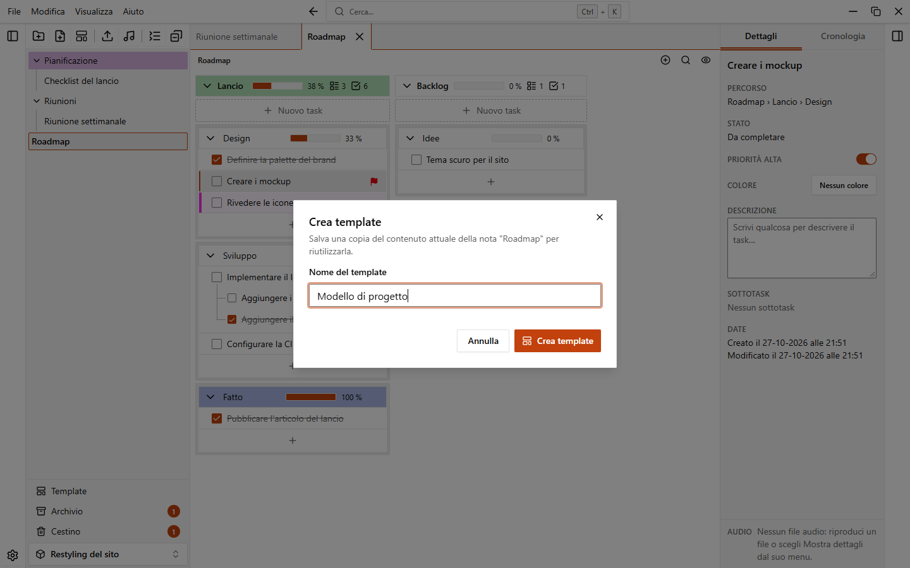
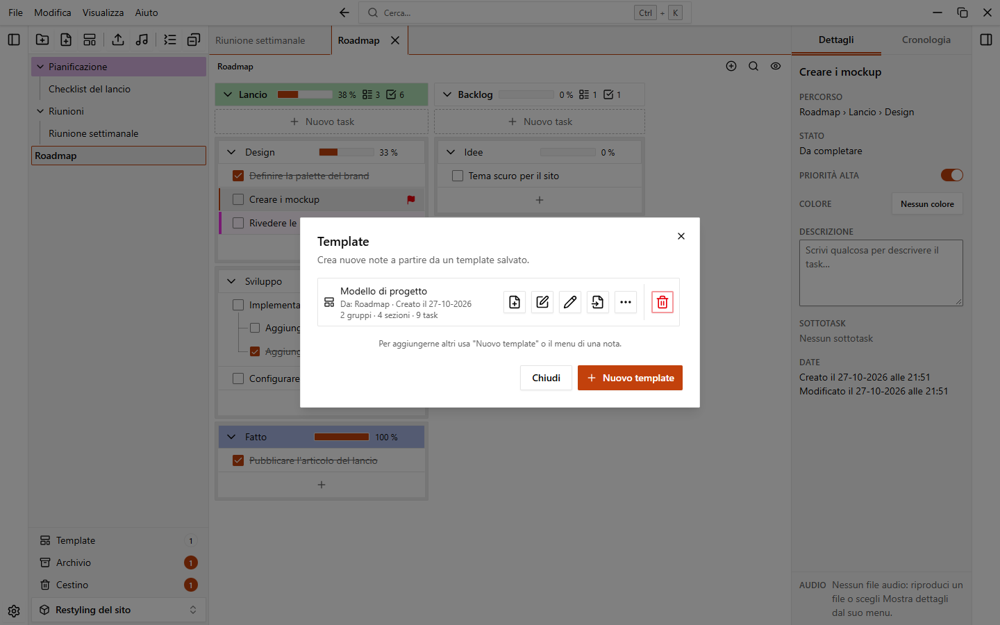
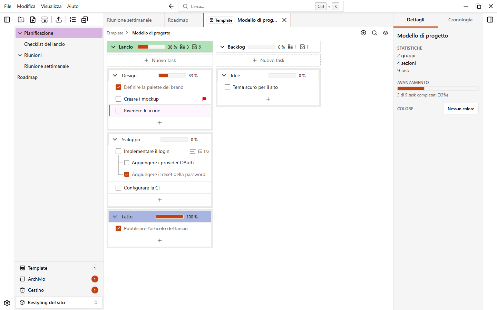

# Template

Un template è una copia salvata di una nota. Usalo per iniziare nuove note con la stessa struttura, per esempio un piano settimanale o una checklist di progetto.

I template appartengono a un workspace: ogni workspace ha i suoi e non sono condivisi tra workspace.

## Creare un template da una nota

1. Apri il menu della nota nella barra laterale (il pulsante **...** o il clic destro).
2. Scegli **Crea template**.
3. Scrivi un **Nome del template** e conferma.

Puoi anche aprire la finestra dei template e fare clic su **Nuovo template**: ti chiede di scegliere una nota e poi il nome. Il nome deve essere unico nel workspace.

### Cosa copia un template

Il template è un'istantanea indipendente della nota in quel momento. Le modifiche successive alla nota non lo cambiano.

| Copiato | Non copiato |
| --- | --- |
| Gruppi, sezioni, task e sottotask, nel loro ordine (anche il posto della lista dei task del gruppo) | File audio |
| Descrizioni dei task, stato di completamento e priorità | Gruppi, sezioni e task archiviati |
| I colori della nota, dei gruppi, delle sezioni e dei task | Elementi nel cestino |
| | [Automazioni](./automations) |

## Creare una nota da un template

Ci sono tre modi:

- Nella finestra **Nuova nota**, scegli un template nel campo **Da template**. Il campo compare quando il workspace ha almeno un template. **Nessun template** crea una nota vuota.
- Dal menu **File > Nuova nota da template…** (o dal pulsante **Nuova nota da template** in fondo alla barra laterale). Scegli il template e compila la finestra.
- Nella finestra dei template, fai clic su **Crea nota** sul template che vuoi.

La finestra **Nuova nota da template** chiede un **Nome** e una **Destinazione**: la radice del workspace o una delle cartelle. Fai clic su **Crea**. La nota viene aggiunta in fondo alla destinazione e si apre. Parte con il colore del template.

## La finestra dei template

Aprila dal pulsante **Template** in fondo alla barra laterale (mostra quanti template hai) oppure da **File > Template…**.

Usa la casella di ricerca per trovare un template. Ogni template mostra la nota da cui è stato creato e la data di creazione. I pulsanti di un template sono:

| Pulsante | Cosa fa |
| --- | --- |
| **Crea nota** | Crea una nota dal template |
| **Modifica** | Apre il template in una scheda per modificarlo (vedi [Modificare un template](#modificare-un-template)) |
| Rinomina | Cambia il nome del template |
| **Aggiorna dalla nota** | Sostituisce il contenuto del template con quello attuale della nota di origine. L'app chiede conferma con **Sovrascrivi template**. Le note già create dal template non cambiano |
| **Altre azioni** (**...**) | **Duplica** crea una copia del template. **Aggiorna da un'altra nota** sostituisce il contenuto con quello di una nota che scegli, che diventa la nota di origine (l'app chiede conferma) |
| **Elimina** | Sposta il template nel cestino |

**Aggiorna dalla nota** è disattivato quando la nota di origine non esiste più o è nel cestino ("La nota di origine non esiste più"), e anche mentre il template è aperto nel suo editor (chiudi prima l'editor).
## Modificare un template

Fai clic su **Modifica** su un template: si apre in una scheda tra le note aperte, con il badge **Template** così non lo scambi mai per una nota. Lo modifichi come una nota qualsiasi: aggiungi gruppi, sezioni e task, cambi i colori, trascini per riordinare, annulli e ripeti.

- **Salvataggio automatico.** Non c'è un pulsante di salvataggio. Un piccolo stato accanto al percorso mostra **Salvataggio...** e poi **Salvato**; se il salvataggio non riesce compare un errore con **Riprova**. Le note già create dal template non cambiano.
- **Duplica.** Nel menu **...** del template, **Duplica** crea una copia che puoi modificare separatamente.
- **Aggiorna da un'altra nota.** Nello stesso menu, **Aggiorna da un'altra nota...** sostituisce il contenuto con quello di una nota che scegli, che diventa la nota di origine.
- **Recupero.** Se l'app viene chiusa mentre un template è aperto, le modifiche non si perdono. Con l'opzione **Riapri le note all'avvio** attiva, la scheda si riapre dove l'avevi lasciata. Con l'opzione spenta, le modifiche vengono salvate nel template all'avvio e un avviso ti dice che sono state recuperate.

In un template le azioni che non hanno senso sono nascoste: archivio, audio e [automazioni](./automations). L'eliminazione di un elemento mostra un breve avviso "Eliminato" al posto del solito, e l'annulla funziona sul template finché la sua scheda è aperta.

Chiudi la scheda (o usa **Chiudi editor** nel suo menu) quando hai finito: il template conserva quello che hai scritto.
Un template eliminato va nel cestino, nella scheda **Template**: da lì puoi ripristinarlo. Vedi [Cestino e archivio](./trash-and-archive).
