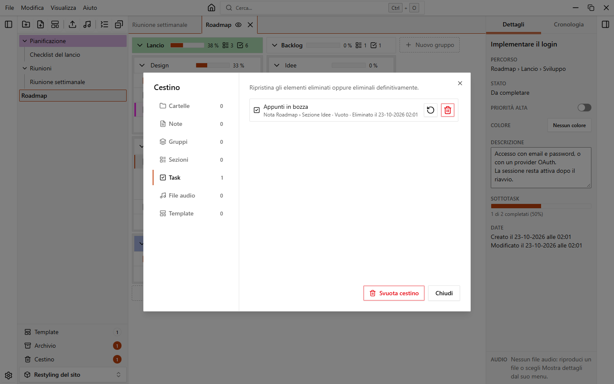
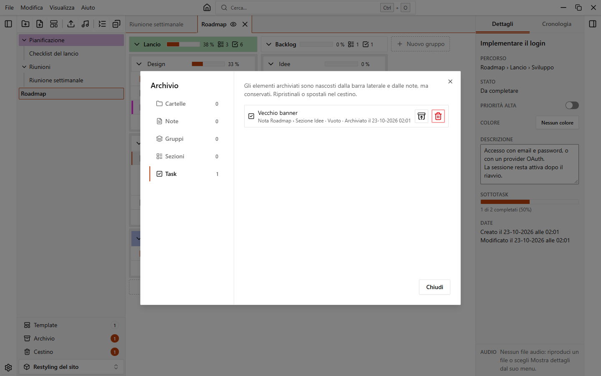

# Cestino e archivio

Quando elimini qualcosa, finisce prima nel cestino, così puoi riportarlo indietro. L'archivio serve per le cose che vuoi nascondere ma conservare.

## Spostare nel cestino

Apri il menu di un elemento e scegli **Elimina**. L'app chiede "Spostare nel cestino?" e confermi con **Sposta nel cestino**. Puoi eliminare workspace, cartelle, note, gruppi, sezioni, task, file audio e [template](./templates).

Per eliminare più cartelle e note insieme, selezionale nella barra laterale (`Ctrl+clic` aggiunge un elemento, `Maiusc+clic` seleziona un intervallo), apri il menu di una di esse e scegli **Elimina N elementi**.

Finché l'elemento è nel cestino, l'eliminazione è sempre reversibile. Puoi anche annullarla con `Ctrl+Z`, vedi [Annulla e cronologia](./undo-and-history).

## Il cestino di un workspace

Aprilo con il pulsante **Cestino** in fondo alla barra laterale (mostra quanti elementi contiene) oppure con **File > Cestino…**.

Gli elementi sono raggruppati per tipo, una scheda per ciascuno: **Cartelle**, **Note**, **Gruppi**, **Sezioni**, **Task**, **File audio** e **Template**. Ogni scheda mostra quanti elementi ha. Una riga mostra il nome, dov'era l'elemento, cosa conteneva e quando è stato eliminato ("Eliminato il…").

| Pulsante | Cosa fa |
| --- | --- |
| **Ripristina** | Riporta indietro l'elemento |
| **Elimina definitivamente** | Elimina l'elemento per sempre. L'app chiede conferma e avverte che non si può annullare |
| **Svuota cestino** | In fondo alla finestra: elimina tutto il contenuto del cestino del workspace, dopo una conferma |

Quando ripristini un elemento che era dentro qualcosa che è a sua volta nel cestino (per esempio un task in una nota eliminata), i contenitori tornano insieme a lui, così l'elemento non resta nascosto.

::: warning
**Elimina definitivamente** e **Svuota cestino** non si possono annullare. Cancellano anche la cronologia delle azioni annullabili.
:::

## Il cestino dei workspace

Nella home, il pulsante del cestino accanto ai workspace (o **File > Cestino…**) apre il cestino dei workspace. Ha gli stessi pulsanti, e ogni riga indica quante cartelle e note tornano insieme al workspace.

## Svuotare il cestino automaticamente

EasyTask può eliminare da solo gli elementi vecchi del cestino.

1. Apri **Impostazioni > Dati**.
2. Nella sezione **Cestino**, scegli un valore per **Svuota automaticamente il cestino**.

| Opzione | Effetto |
| --- | --- |
| **Mai** | Non viene eliminato nulla in automatico. È il valore predefinito |
| **Dopo 7 giorni** | |
| **Dopo 30 giorni** | |
| **Dopo 90 giorni** | |

All'avvio l'app elimina definitivamente ciò che è nel cestino da più del tempo scelto, in tutti i workspace. Un messaggio ti dice quanti elementi sono stati eliminati.

## L'archivio

Archiviare nasconde un elemento dalla barra laterale e dalla nota senza spostarlo nel cestino. Usalo per le cose che hai finito ma che potrebbero servirti ancora.

Puoi archiviare cartelle, note, gruppi, sezioni e task. Ciò che l'elemento contiene viene nascosto con lui: una cartella archiviata nasconde le sue note, un task archiviato nasconde i suoi sottotask.

Per archiviare un elemento, apri il suo menu e scegli **Archivia**. Non c'è conferma e puoi annullare con `Ctrl+Z`. Per archiviare più cartelle e note insieme, selezionale e scegli **Archivia N elementi** nel menu.

Anche un'[automazione](./automations) può archiviare un gruppo.

## La finestra dell'archivio

Aprila con il pulsante **Archivio** in fondo alla barra laterale (con il numero di elementi archiviati) oppure con **File > Archivio…**.

C'è una scheda per ogni tipo: **Cartelle**, **Note**, **Gruppi**, **Sezioni** e **Task**. Una riga mostra il nome, dov'era e quando è stato archiviato ("Archiviato il…").

| Pulsante | Cosa fa |
| --- | --- |
| **Ripristina** | Riporta l'elemento dov'era. Se si trova dentro elementi archiviati (per esempio un task in un gruppo archiviato), tornano anche quelli |
| **Sposta nel cestino** | Sposta l'elemento nel cestino, dopo una conferma |
