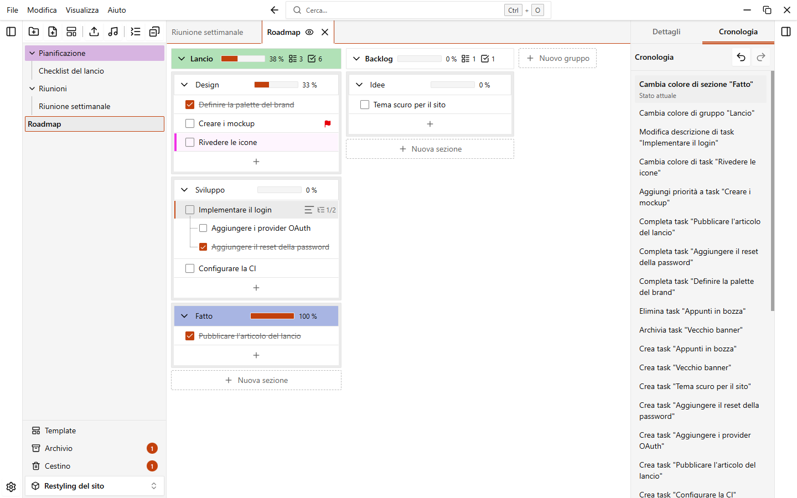

# Annulla e cronologia

EasyTask ricorda le tue ultime azioni nel workspace aperto. Puoi annullarle, ripeterle o tornare a un punto qualsiasi dalla scheda **Cronologia**.

## Annulla e ripeti

| Azione | Scorciatoia |
| --- | --- |
| Annulla l'ultima azione | `Ctrl+Z` |
| Ripeti l'azione annullata | `Ctrl+Y` oppure `Ctrl+Maiusc+Z` |

Puoi usare anche **Annulla** e **Ripeti** nel menu **Modifica** del menu dell'applicazione, o i due pulsanti in alto nella scheda Cronologia.

Ogni annullamento o ripetizione mostra un avviso, per esempio "Annullato: Rinomina task". L'avviso ha un pulsante per l'azione opposta, così puoi ripensarci subito.

::: info Campi di testo
In un campo di testo, `Ctrl+Z` e `Ctrl+Y` annullano e ripetono il testo che stai scrivendo, non la cronologia del workspace. Clicca fuori dal campo per usare la cronologia del workspace.
:::

Puoi cambiare `Ctrl+Z` e `Ctrl+Y` in **Impostazioni > Scorciatoie**. `Ctrl+Maiusc+Z` è fissa. Vedi [Scorciatoie da tastiera](./shortcuts).

Con lo [spazio di lavoro diviso](./folders-and-notes#dividere-lo-spazio-di-lavoro) in due aree la cronologia resta una sola per tutto il workspace. Se annulli o ripeti un'azione fatta sulla nota dell'altra area, anche quella nota viene aggiornata.

## Cosa si può annullare

Puoi annullare le modifiche al contenuto di un workspace, per esempio:

- rinominare una cartella, nota, gruppo, sezione o task
- cambiare un colore, anche di più elementi insieme
- completare o riaprire un task, aggiungere o togliere la priorità, modificare la descrizione
- creare un elemento
- eliminare un elemento o più elementi selezionati (tornano dal [cestino](./trash-and-archive))
- archiviare e ripristinare dall'archivio
- spostare cartelle, note, sezioni e task, anche trascinandoli
- applicare un'[automazione](./automations)

Ogni voce della cronologia ha un nome che dice cosa ha fatto, per esempio "Elimina task "Comprare il latte"" o "Archivia 3 elementi".

## Annullare da un avviso

Quando elimini qualcosa, l'avviso che lo conferma ha un pulsante **Annulla**. Cliccalo per riportare indietro gli elementi. Il pulsante annulla l'ultima azione, quindi usalo subito dopo l'eliminazione.

L'avviso di un'automazione ha lo stesso pulsante. Se nel frattempo hai fatto altro, usa la cronologia.

## La scheda Cronologia

Apri il pannello a destra e scegli la scheda **Cronologia**. Mostra o nascondi il pannello con `Ctrl+Maiusc+B`.

- L'elenco mostra le azioni che puoi annullare, la più recente in alto. Quella in cima è segnata come **Stato attuale**.
- Clicca una voce per tornare a quel punto. EasyTask annulla tutte le azioni che stanno sopra, in un solo passaggio.
- Sotto la linea ci sono le azioni annullate, segnate come **Annullata**. Cliccane una per ripetere tutto fino a quel punto.

Un'azione su più elementi selezionati (cartelle, note o task) è una sola voce, qualunque sia il numero di elementi coinvolti.

Se fai una nuova azione, l'elenco delle azioni annullate si svuota: non puoi più ripetere quello che avevi annullato.

## Limiti

- La cronologia appartiene al workspace aperto. Si svuota quando apri un altro workspace o torni alla pagina iniziale.
- Vive solo in memoria. Quando chiudi l'app, sparisce.
- Si svuota quando elimini definitivamente un elemento dal cestino o svuoti il cestino.
- Di default vengono tenute le ultime 50 azioni. Scegli 25, 50, 100, 200 o 500 in **Impostazioni > Dati > Cronologia > Azioni annullabili**. Le azioni più vecchie vengono dimenticate.
- Un'azione che fallisce quando la annulli viene tolta dalla cronologia e un avviso te lo dice.
