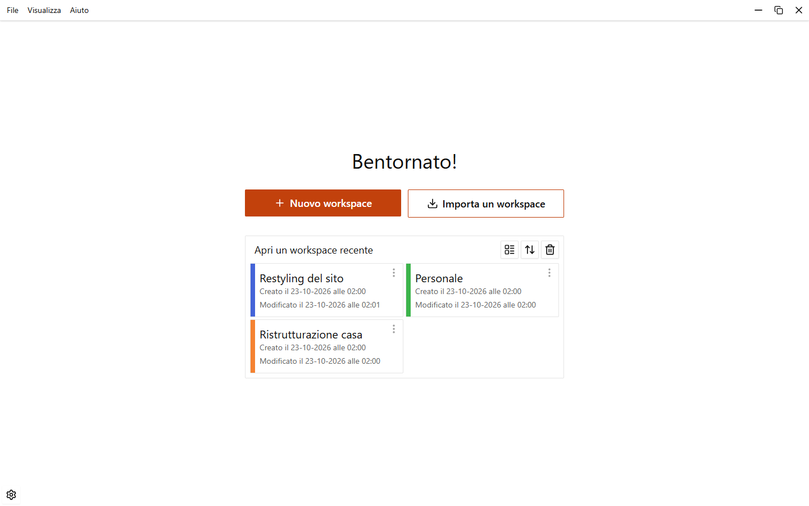
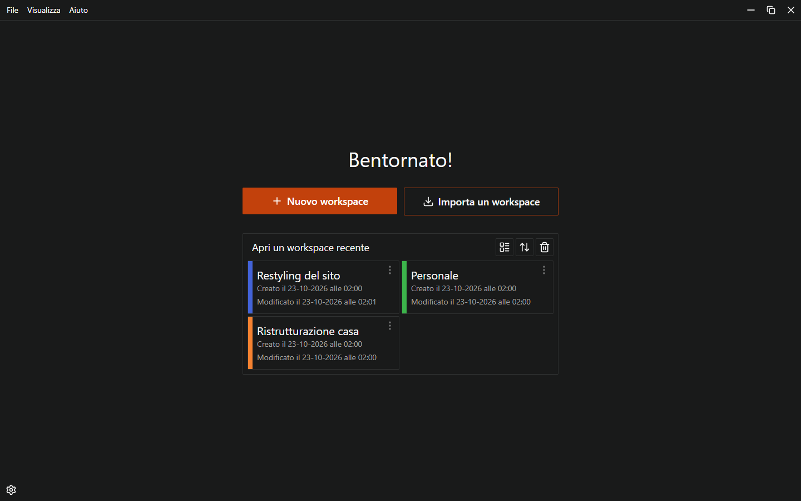
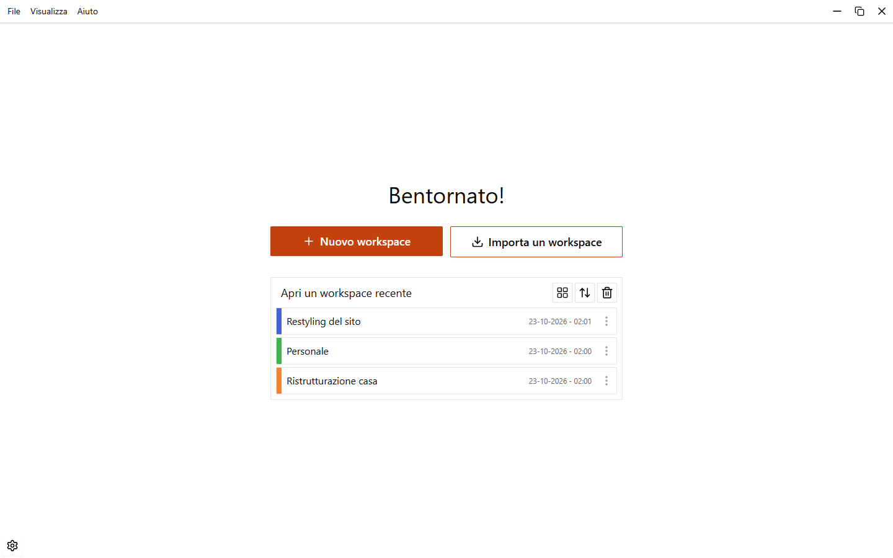
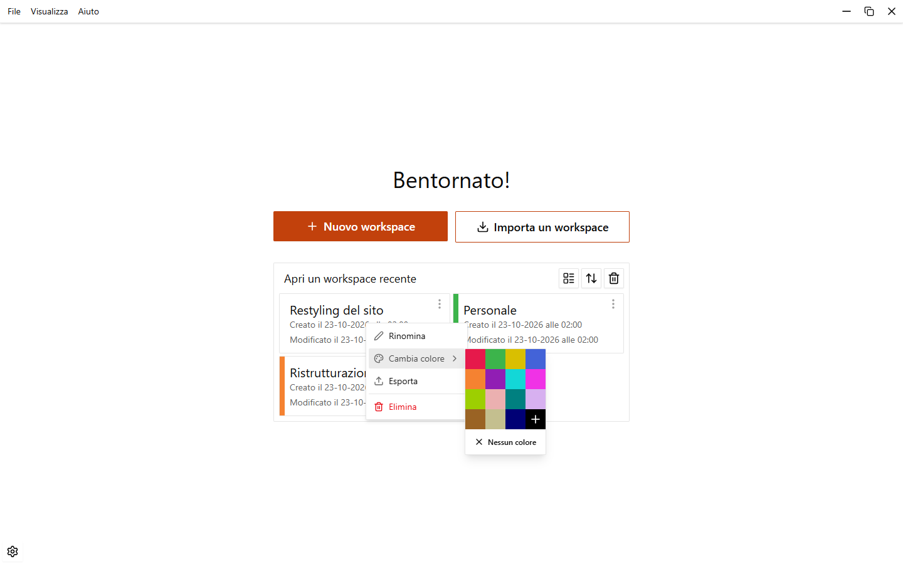

# Workspace

Il workspace è il livello più alto di EasyTask: contiene le tue cartelle e le tue note. Usa un workspace per ogni progetto o ambito della tua vita. La home li elenca tutti.

{.light-only}
{.dark-only}

## La home

La home mostra **Bentornato!**, i due pulsanti **Nuovo workspace** e **Importa un workspace**, e l'elenco **Apri un workspace recente**.

Sopra l'elenco ci sono tre pulsanti:

| Pulsante                              | Cosa fa                                                                                  |
| ------------------------------------- | ---------------------------------------------------------------------------------------- |
| **Visualizza come lista** / **Visualizza come griglia** | Passa dalle schede alle righe compatte. EasyTask ricorda la scelta. |
| **Ordina**                            | Ordina per **Ultima modifica**, **Data creazione** o **Nome**, in entrambe le direzioni. |
| **Cestino**                           | Apre i workspace eliminati. Vedi [Cestino e archivio](./trash-and-archive).              |

Fai clic su un workspace per aprirlo. La scheda mostra il nome, una barra colorata a sinistra (se gli hai dato un colore) e le date di creazione e di modifica.

::: tip
Se chiudi l'app mentre un workspace è aperto, EasyTask può riaprirlo al prossimo avvio. Attiva o disattiva l'opzione in **Impostazioni > Note e sezioni > Riapri l'ultimo workspace all'avvio**.
:::

## Creare un workspace

1. Fai clic su **Nuovo workspace**, oppure premi `Ctrl+N` nella home.
2. Scrivi un nome in **Nome**.
3. Se vuoi, scegli un colore con il pulsante accanto al nome.
4. Fai clic su **Crea workspace**.

I nomi dei workspace sono unici: se il nome è già usato, la finestra mostra un errore e scegli un altro nome.

## Rinominare, colorare, esportare, eliminare

Fai clic sul pulsante del menu di un workspace (compare quando passi il mouse sulla scheda), oppure fai clic destro sulla scheda.

| Voce               | Cosa fa                                                                                        |
| ------------------ | ---------------------------------------------------------------------------------------------- |
| **Rinomina**       | Il nome diventa un campo di testo sul posto. `Invio` salva, `Esc` annulla.                     |
| **Cambia colore**  | Imposta o toglie la barra colorata della scheda.                                               |
| **Esporta**        | Salva il workspace in un file. Vedi sotto.                                                     |
| **Elimina**        | Chiede conferma (**Sposta nel cestino**), poi sposta il workspace nel cestino.                 |

Eliminare non distrugge nulla: puoi ripristinare il workspace dal **Cestino** della home finché non lo svuoti. Dettagli in [Cestino e archivio](./trash-and-archive).

## Esportare un workspace

1. Apri il menu del workspace e scegli **Esporta**. Dentro un workspace puoi usare anche **File > Esporta workspace…**.
2. Scegli dove salvare. Il nome proposto è `<nome del workspace>.easytask.json`.

Il file contiene le cartelle e le note del workspace con il loro contenuto (gruppi, sezioni, task), le automazioni delle note e i template. Gli elementi nel cestino non sono inclusi. Usalo per spostare un workspace su un altro computer o per tenerne una copia.

::: info
Il file contiene i percorsi dei file audio, non l'audio.
:::

## Importare un workspace

1. Nella home fai clic su **Importa un workspace**.
2. Scegli un file `.easytask.json`.
3. EasyTask mostra la finestra **Importa** con il **Nome del workspace** da usare. Controllalo, cambialo se vuoi e fai clic su **Importa**.

Il nome proposto è già libero. Se esiste un workspace con lo stesso nome (anche nel cestino), EasyTask aggiunge un suffisso, per esempio `Restyling del sito (importato)`, poi `(importato 2)` e così via. Se scrivi un nome già usato, la finestra mostra un errore e resta aperta, così puoi cambiarlo.

Dopo l'importazione un messaggio ti dice se alcuni file audio sono stati saltati. I file audio che non si trovano sul computer vengono saltati, tutto il resto viene importato.

Alcuni limiti:

- Il file deve essere un'esportazione di EasyTask, di al massimo 50 MB.
- Un file che contiene solo una nota o una cartella non si può importare da qui: apri un workspace e usa **Importa una nota o una cartella** nella barra laterale. Vedi [Cartelle e note](./folders-and-notes).

## Il menu dell'applicazione

In alto nella finestra c'è un menu di testo. Nella home ha meno voci che dentro un workspace.

| Menu          | Voci nella home                                                                       |
| ------------- | ------------------------------------------------------------------------------------- |
| **File**      | **Nuovo workspace…**, **Cestino…**, **Impostazioni…**, **Esci**                       |
| **Visualizza**| **Tema**: chiaro, scuro o di sistema                                                  |
| **Aiuto**     | **Scorciatoie da tastiera…**, **Note di rilascio**, **Informazioni e aggiornamenti…** |

Premi `Alt` da solo oppure `F10` per portare il focus sul menu e usarlo da tastiera.
